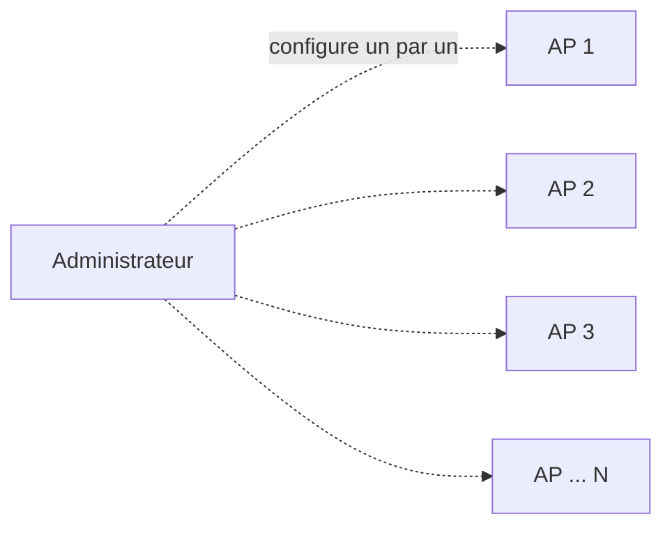
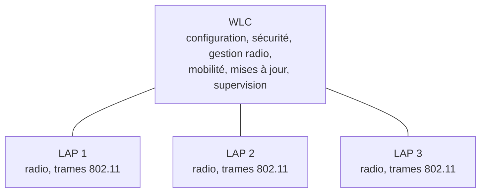

# Chapitre 1 – Pourquoi un contrôleur sans fil ?

**Objectif :** comprendre le problème que résout un contrôleur sans fil (WLC) et la grande idée de l'architecture centralisée.

## 1.1 Le point de départ : le point d'accès autonome

À la maison, vous avez probablement un « routeur Wi-Fi ». À l'intérieur se trouve un **point d'accès (AP)** : il émet un SSID, vérifie le mot de passe des appareils qui se connectent et les relie au réseau filaire. Tout est configuré **dans la boîte elle-même**. On dit que ce point d'accès est **autonome** (*autonomous AP*).

Ce modèle fonctionne très bien pour un logement. Imaginez maintenant un cégep, un hôpital ou une usine : **des centaines de points d'accès**, répartis dans plusieurs bâtiments.

### Les problèmes qui apparaissent

| Problème | Conséquence concrète |
|---|---|
| **Configuration répétitive** | Changer le mot de passe d'un SSID sur 200 points d'accès demande 200 interventions |
| **Incohérences** | Un AP oublié garde l'ancienne configuration : certains utilisateurs se connectent, d'autres non |
| **Radio mal réglée** | Les canaux et les puissances sont choisis à la main. Deux AP voisins sur le même canal se nuisent |
| **Itinérance (*roaming*)** | Les AP ne se coordonnent pas : un utilisateur qui se déplace perd sa connexion le temps de se réassocier |
| **Sécurité** | Politique de sécurité à répéter partout. Un AP « pirate » branché dans une prise est difficile à repérer |
| **Mises à jour** | Chaque AP doit être mis à jour individuellement |
| **Visibilité** | Aucune vue d'ensemble : combien de clients, où, et avec quelle qualité ? |

## 1.2 La grande idée : séparer la gestion du travail radio

L'architecture **centralisée** retire l'intelligence de gestion des points d'accès pour la placer dans un équipement unique : le **contrôleur sans fil**, ou **WLC** (*Wireless LAN Controller*).

- Les points d'accès deviennent des équipements **légers** : les **LAP** (*Lightweight Access Points*). Ils font le travail qui doit se passer *tout de suite*, à côté de l'antenne.
- Le WLC fait le travail de **gestion et de décision**, pour **tous** les LAP à la fois.

### Qui fait quoi ?

Le travail est réparti selon un critère simple : **est-ce que ça doit se faire en temps réel, au contact de la radio ?**

| Travail | Où ? | Pourquoi |
|---|---|---|
| Émettre et recevoir sur la radio, envoyer les balises (*beacons*), accuser réception des trames | **LAP** | Trop rapide pour être déporté |
| Décider quels canaux et quelles puissances utiliser (RRM) | **WLC** | Il faut une vue d'ensemble de tous les AP |
| Appliquer la politique de sécurité, dialoguer avec le serveur d'authentification | **WLC** (ou LAP, selon la configuration) | Politique unique et cohérente |
| Gérer la mobilité d'un client qui passe d'un AP à l'autre | **WLC** | Il connaît tous les AP |
| Mettre à jour le logiciel des AP | **WLC** | Une seule image à gérer |
| Conserver la configuration | **WLC** | Les LAP la reçoivent au démarrage |

:::info[À retenir]
Dans l'architecture centralisée, le **WLC pense** et le **LAP émet**. Le LAP n'a pas de configuration permanente propre : il la **reçoit du WLC** chaque fois qu'il se joint à lui.
:::

:::note[Un partage qui peut varier]
Quelles fonctions sont exécutées par le WLC ou par le LAP peut se configurer (commutation, authentification, DHCP, association). C'est le sujet du module 2 (commutation locale ; la commutation centrale viendra dans un cours ultérieur). Pour l'instant, retenez seulement le principe de la séparation.
:::

## 1.3 Autonome ou centralisé : comparaison

| Critère | AP autonome | AP léger + WLC |
|---|---|---|
| Où se trouve la configuration ? | Dans chaque AP | Dans le WLC |
| Ajouter un AP | Le configurer entièrement | Le brancher : il se joint au WLC et reçoit sa configuration |
| Gestion des canaux et puissances | Manuelle | Automatique (RRM) |
| Vue d'ensemble | Non | Oui |
| Mises à jour | AP par AP | Centralisées |
| Coût | Faible (un équipement) | Plus élevé (un WLC en plus) |
| Cas typique | Maison, très petit commerce | Entreprise, campus, hôpital |

## 1.4 Les formes que peut prendre un WLC

Le WLC est un **logiciel**. Il peut tourner sur différents supports, comme un routeur peut être une boîte physique ou une machine virtuelle.

| Forme | Exemple | Remarque |
|---|---|---|
| **Boîte physique** | Cisco Catalyst 9800-L, 9800-40, 9800-80 | Déploiement classique en entreprise |
| **Machine virtuelle** | Cisco Catalyst 9800-CL | Utilisée en laboratoire dans ce cours |
| **Intégré à un commutateur** | Contrôleur sans fil intégré à certains Catalyst 9000 | Pour les petits sites |
| **Dans le nuage** | Solutions gérées dans le nuage (ex. Meraki) | Hors du sujet de ce cours |

:::tip[Rappel utile]
Un routeur n'est pas la boîte, c'est le **logiciel** qu'elle exécute. C'est exactement la même chose pour un WLC : le 9800-CL est le même logiciel que celui des boîtes physiques, mais exécuté dans une machine virtuelle.
:::

## À retenir

- Un AP **autonome** se configure seul ; ce modèle ne passe pas à l'échelle.
- Dans le modèle **centralisé**, le **WLC** gère et décide, le **LAP** s'occupe de la radio.
- Le LAP **reçoit sa configuration du WLC** : l'ajouter à un réseau est simple.
- Le WLC est un logiciel, physique ou virtuel.

## Vérifiez votre compréhension

**Question 1.** Un administrateur doit changer la clé d'un SSID sur 150 points d'accès. Décrivez la différence de travail entre un réseau d'AP autonomes et un réseau avec WLC.

Voir le corrigé

Avec des AP autonomes, il faut se connecter aux 150 points d'accès et modifier chacun individuellement, avec un risque d'oubli ou d'erreur. Avec un WLC, on modifie le profil du SSID **une seule fois** dans le contrôleur, et la modification est appliquée aux LAP concernés.

**Question 2.** Pourquoi la gestion des canaux radio gagne-t-elle à être centralisée ?

Voir le corrigé

Pour bien choisir un canal et une puissance, il faut connaître la position et l'environnement radio de **tous** les points d'accès voisins. Seul un équipement qui voit l'ensemble peut éviter que deux AP proches utilisent le même canal. Un AP autonome ne connaît que lui-même.

**Question 3.** Vrai ou faux : un LAP conserve en permanence sa configuration SSID même sans contact avec un WLC.

Voir le corrigé

**Faux** dans le modèle de base : le LAP reçoit sa configuration du WLC lorsqu'il se joint à lui. Certains modes (FlexConnect) permettent au LAP de continuer à fonctionner si le contact avec le WLC est perdu, mais cela se prépare par une configuration précise, vue dans un autre module.

