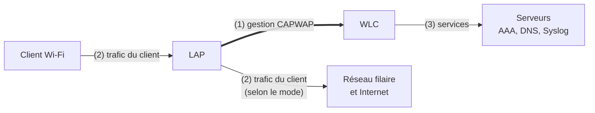

# Chapitre 2 – Les composants : LAP, WLC et leurs rôles

**Objectif :** identifier chaque composant, ce qu'il fait, et le rattacher à ce que vous connaissez déjà du réseau filaire.

## 2.1 Le LAP (point d'accès léger)

Un **LAP** (*Lightweight Access Point*) est un point d'accès qui **ne fonctionne pas seul**. Au démarrage :

1. il obtient une **adresse IP** (en général par DHCP) ;
2. il **cherche** un WLC ;
3. il **se joint** au WLC ;
4. il **reçoit sa configuration** : SSID, sécurité, réglages radio, etc.

Ce qu'il faut savoir sur un LAP :

- Il est généralement **alimenté par le câble réseau** (PoE : *Power over Ethernet*) : un seul câble apporte les données et le courant.
- Il possède une ou plusieurs **radios** (2,4 GHz, 5 GHz, parfois 6 GHz).
- Il se comporte comme un **équipement terminal** vu du réseau filaire : il se branche sur un port du commutateur d'accès.

## 2.2 Le WLC (contrôleur sans fil)

Le **WLC** est le cerveau du réseau sans fil. Son système d'exploitation est **IOS XE**, le même que sur plusieurs équipements Cisco : vous y retrouverez le CLI que vous connaissez (`hostname`, `username`, `ip route`, `show ...`).

Ce qu'il faut savoir sur un WLC :

- Il possède une **table de routage** et peut avoir une **route par défaut**. Ce n'est pas réservé aux routeurs : tout équipement qui parle IP en a une.
- Il porte une **interface de gestion sans fil**, la **WMI** (*Wireless Management Interface*). C'est son adresse « officielle » pour :
  - la communication avec les **LAP** ;
  - l'**accès web** d'administration ;
  - les échanges avec d'autres serveurs : authentification (AAA/RADIUS), journalisation (Syslog), supervision (SNMP).
- Il utilise un **certificat** pour chiffrer ses échanges avec les LAP (nous y reviendrons au chapitre 6).

:::warning[Piège fréquent]
Le WLC **n'est pas un commutateur** et **ne participe pas à STP**. Il se branche sur la distribution comme le ferait un serveur. Ne cherchez pas à le placer « dans » la boucle de commutation.
:::

## 2.3 Les trois flux de trafic

Pour ne pas se perdre, distinguons trois types de trafic qui existent dans un réseau sans fil centralisé.

| Flux | Entre qui ? | Contenu | Où le voit-on ? |
|---|---|---|---|
| **(1) Gestion** | LAP ↔ WLC | Configuration, états, ordres du WLC | Canal de **contrôle** CAPWAP |
| **(2) Données du client** | Client → LAP → (WLC ou réseau filaire) | Le trafic réel de l'utilisateur | Selon le mode : tunnel CAPWAP vers le WLC, ou directement sur le commutateur d'accès |
| **(3) Services** | WLC ↔ serveurs | Authentification, journaux, supervision | Du WLC vers le réseau, via la WMI |

Ce module se concentre sur le flux **(1)** : comment un LAP et un WLC **se trouvent** et **s'entendent**. Le flux **(2)** est l'objet du module sur la commutation centrale et locale.

## 2.4 Tableau d'équivalences avec le réseau filaire

| Nouveauté sans fil | Se rattache à | Pour retenir |
|---|---|---|
| **LAP** | Un équipement branché sur un port de la couche **accès** | Un port de commutateur d'accès, mais qui parle en radio |
| **WLC** | Un équipement raccordé à la **distribution** (comme un serveur) | Il centralise la gestion |
| **SSID** | Un **VLAN** utilisateur supplémentaire | Un réseau Wi-Fi est associé à un VLAN |
| **Passerelle des clients** | **SVI** d'un MLS avec **HSRP** | Aucun changement |
| **WMI du WLC** | L'adresse de gestion d'un équipement | Comme l'interface de gestion d'un commutateur |

## À retenir

- Le **LAP** est un AP léger : sans WLC, il ne sert à rien (dans le modèle de base).
- Le **WLC** gère tous les LAP. Son adresse de référence est la **WMI**.
- Le WLC ne participe pas à STP ; c'est un équipement terminal pour la couche réseau.
- Il y a **trois flux** à distinguer : gestion, données des clients, services.

## Vérifiez votre compréhension

**Question 1.** Quelle est la fonction de la WMI ?

Voir le corrigé

C'est l'interface IP de gestion du WLC. Elle sert aux échanges avec les LAP, à l'accès web d'administration, et à la communication avec les serveurs (AAA, Syslog, SNMP).

**Question 2.** Un collègue propose de brancher le WLC sur un port « accès » avec STP en mode normal, comme un commutateur. Qu'en pensez-vous ?

Voir le corrigé

Le WLC n'est **pas** un commutateur : il ne participe pas à STP, il ne faut donc pas l'envisager comme un maillon de la boucle de commutation. Il se connecte à la distribution comme un serveur ou un équipement terminal.

**Question 3.** Quels sont les trois flux de trafic d'un réseau sans fil centralisé ?

Voir le corrigé

(1) Le flux de **gestion** entre LAP et WLC (canal de contrôle CAPWAP) ; (2) le flux des **données des clients** ; (3) le flux entre le WLC et les **serveurs** de services (authentification, journalisation, supervision).

