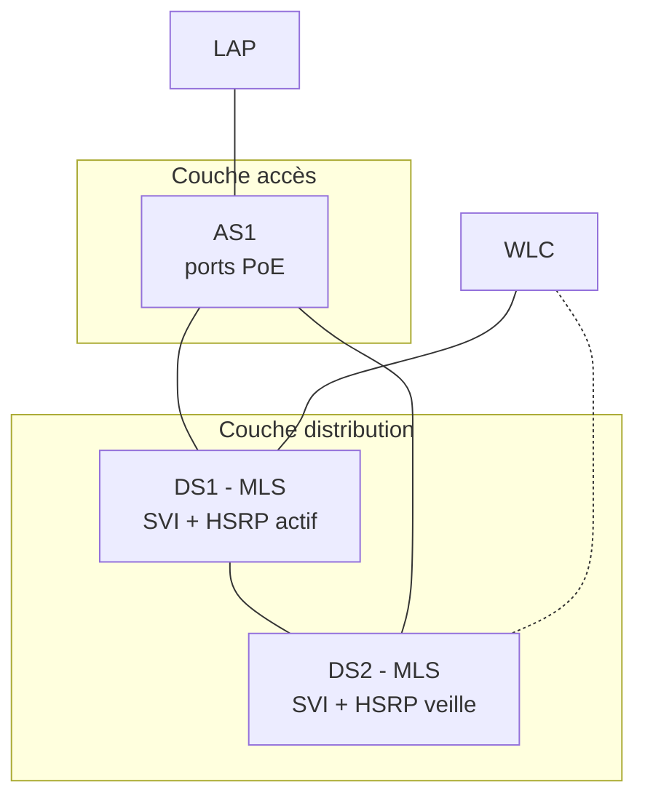
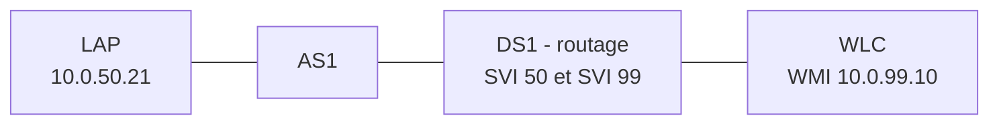

# Chapitre 3 – Où brancher quoi dans l'accès-distribution

**Objectif :** placer correctement le WLC et les LAP dans une topologie accès-distribution, avec les VLAN, les ports et la passerelle qui conviennent.

## 3.1 Rappel : la topologie de départ

Vous la connaissez : deux commutateurs de distribution (MLS) reliés entre eux, avec **HSRP** pour les passerelles, et des commutateurs d'accès raccordés aux deux.



Le sans-fil **ne change rien** à cette base. Il y ajoute deux types d'équipements.

## 3.2 Où brancher le LAP : sur l'accès

Le LAP se branche sur un port **PoE** du commutateur d'accès, comme un téléphone IP. Ce port peut être configuré de deux façons, selon le **mode de fonctionnement** du LAP.

| Mode du LAP | Type de port | VLAN | Pourquoi |
|---|---|---|---|
| **Commutation centrale** (le trafic des clients est envoyé au WLC) | **Accès** | Le VLAN des LAP (ex. 50) | Le LAP n'a besoin que d'une adresse IP et d'un tunnel vers le WLC |
| **Commutation locale** (le LAP dépose le trafic des clients sur l'accès) | **Trunk** | VLAN natif = VLAN des LAP ; VLAN des clients en étiquettes 802.1Q | Le LAP doit pouvoir émettre plusieurs VLAN |

:::info[À retenir]
Dans les deux cas, le LAP obtient **toujours** son adresse IP dans le **VLAN non étiqueté** de son port : le VLAN d'accès, ou le **VLAN natif** s'il est en trunk.
:::

Configuration d'un port d'accès pour un LAP en commutation centrale :

```text
interface GigabitEthernet1/0/10
 description LAP-01
 switchport mode access
 switchport access vlan 50
 spanning-tree portfast
```

Configuration d'un port trunk pour un LAP en commutation locale (clients dans les VLAN 110 et 120) :

```text
interface GigabitEthernet1/0/10
 description LAP-01 (commutation locale)
 switchport mode trunk
 switchport trunk native vlan 50
 switchport trunk allowed vlan 50,110,120
 spanning-tree portfast trunk
```

:::tip[Pourquoi `portfast` ?]
Un LAP est un **équipement terminal** : il n'y a pas de boucle derrière lui. `portfast` évite l'attente de STP au démarrage du port et accélère la jonction du LAP.
:::

## 3.3 Où brancher le WLC : près de la distribution

Le WLC se raccorde généralement à la **distribution** (ou à un bloc de services). Deux raisons :

- tous les LAP le contactent : il doit être **bien centralisé** et accessible depuis tous les VLAN des LAP ;
- avec la commutation centrale, le trafic des clients passe **par lui** : il doit être près du cœur du réseau.

Un WLC physique se relie à la distribution par un ou plusieurs liens, souvent regroupés en **port-channel** configuré en **trunk**.

```text
! Sur DS1 - lien vers le WLC (exemple)
interface Port-channel10
 description Vers WLC
 switchport mode trunk
 switchport trunk allowed vlan 99
!
interface range GigabitEthernet1/0/1 - 2
 channel-group 10 mode active
```

:::warning[Le mode d'agrégation doit correspondre des deux côtés]
Selon la plateforme et la version, le WLC peut prendre en charge une agrégation **statique** (`mode on`), **LACP** ou **PAgP**. Les anciens contrôleurs ne prennent en charge que le mode statique. Le mode côté commutateur doit être **identique** à celui du WLC : si un côté est en LACP et l'autre en statique, le port-channel ne se forme pas. Vérifiez la documentation de votre modèle.
:::

### Cas particulier de votre laboratoire (cette année)

Votre WLC est une **machine virtuelle** (9800-CL) qui n'est **pas** reliée en trunk. Elle utilise une seule interface, configurée comme un **port de couche 3** avec une adresse IP, et déclarée comme interface de gestion :

```text
interface GigabitEthernet1
 no switchport
 ip address 192.168.X.10 255.255.255.0
!
wireless management interface GigabitEthernet1
```

Avec un WLC physique relié par un trunk, on créerait plutôt un VLAN (par exemple le 99), une interface `Vlan99` avec l'adresse de gestion, et on la désignerait comme WMI.

:::note[Pourquoi ça compte]
Le fait que le WLC soit relié en trunk ou non détermine quels scénarios sont possibles en pratique. Les chapitres suivants fonctionnent dans les deux cas.
:::

## 3.4 Deux réseaux IP différents, une seule session

Dans la topologie du module, les LAP sont dans le **VLAN 50** (10.0.50.0/24) et la WMI du WLC dans le **VLAN 99** (10.0.99.0/24). Les LAP et le WLC sont donc dans **deux réseaux IP différents**, séparés par le routage de la distribution.



Cela fonctionne parce que CAPWAP est transporté dans **UDP/IP** : un paquet UDP peut traverser un routeur comme n'importe quel autre paquet IP. Le LAP envoie ses messages à son **routeur par défaut** (la passerelle HSRP 10.0.50.1), qui les achemine vers 10.0.99.10.

:::info[À retenir]
Pour qu'un LAP se joigne à un WLC situé dans un autre réseau, il faut :
1. que le LAP ait une **adresse IP**, un **masque** et une **passerelle** valides ;
2. qu'il **connaisse l'adresse du WLC** (chapitre 5) ;
3. que le réseau laisse passer **UDP 5246 et 5247** entre les deux.
:::

## 3.5 Les services qui accompagnent : DHCP et passerelle

Le DHCP est ici **un acteur clé** : il donne au LAP son adresse, sa passerelle, et peut lui annoncer le WLC avec l'**option 43** (chapitre 5).

Exemple de configuration sur la distribution, avec un serveur DHCP intégré au MLS :

```text
ip dhcp excluded-address 10.0.50.1 10.0.50.10
!
ip dhcp pool LAP-VLAN50
 network 10.0.50.0 255.255.255.0
 default-router 10.0.50.1
 dns-server 10.0.99.5
 option 43 hex f1040a00630a
!
interface Vlan50
 description Reseau des LAP
 ip address 10.0.50.2 255.255.255.0
 standby version 2
 standby 50 ip 10.0.50.1
 standby 50 priority 110
 standby 50 preempt
!
interface Vlan99
 description Reseau du WLC
 ip address 10.0.99.2 255.255.255.0
 standby version 2
 standby 99 ip 10.0.99.1
 standby 99 priority 110
 standby 99 preempt
```

Les LAP reçoivent donc une adresse du réseau 10.0.50.0/24 et la passerelle 10.0.50.1 (adresse **virtuelle HSRP**). La valeur `f1040a00630a` de l'option 43 est expliquée au chapitre 5.

:::tip[Si le DHCP est sur un serveur]
Si vos adresses viennent d'un serveur DHCP centralisé, configurez `ip helper-address <adresse-du-serveur>` sur `interface Vlan50`. Le serveur doit alors porter l'option 43 pour ce réseau.
:::

## 3.6 Ce qu'il faut laisser passer sur le réseau

Si des **pare-feu** ou des **listes de contrôle d'accès** existent entre les LAP et le WLC, ils doivent autoriser :

| Protocole | Port | Rôle |
|---|---|---|
| UDP | **5246** | CAPWAP contrôle (y compris la découverte) |
| UDP | **5247** | CAPWAP données |

Pour mémoriser : **46 = contrôle, 47 = données**.

## À retenir

- Le **LAP** se branche sur l'**accès** : port d'**accès** (commutation centrale) ou **trunk** (commutation locale), toujours avec une adresse IP dans le VLAN non étiqueté.
- Le **WLC** se branche près de la **distribution**, souvent par trunk et port-channel ; il ne participe pas à STP.
- LAP et WLC peuvent être dans des **réseaux IP différents** : CAPWAP traverse le routage.
- Le **DHCP** et la **passerelle HSRP** sont indispensables au LAP ; UDP **5246** et **5247** doivent être permis.

## Vérifiez votre compréhension

**Question 1.** Un LAP est configuré pour la commutation **locale**. Sur le port du commutateur d'accès, quel mode faut-il, et où le LAP obtient-il son adresse IP ?

<details>
<summary>Voir le corrigé</summary>

Il faut un port **trunk**. Le LAP obtient son adresse IP dans le **VLAN natif** (non étiqueté) du port. Les VLAN des clients circulent en étiquettes 802.1Q.

</details>

**Question 2.** Dans la topologie du module, quelle est la passerelle du LAP ? Quel équipement répond réellement à cette adresse ?

<details>
<summary>Voir le corrigé</summary>

La passerelle est **10.0.50.1**, l'adresse **virtuelle HSRP**. Elle est portée par le commutateur de distribution **actif** pour le VLAN 50 (DS1 dans l'exemple).

</details>

**Question 3.** Le LAP et le WLC sont dans deux réseaux IP différents. Pourquoi la jonction peut-elle quand même réussir ?

<details>
<summary>Voir le corrigé</summary>

Parce que CAPWAP est encapsulé dans **UDP/IP** : les paquets sont routés par la distribution comme n'importe quel trafic IP. Il faut cependant que le LAP ait une passerelle valide, qu'il connaisse l'adresse du WLC, et que UDP 5246 et 5247 ne soient pas bloqués.

</details>

**Question 4.** Pourquoi active-t-on `spanning-tree portfast` sur un port de LAP ?

<details>
<summary>Voir le corrigé</summary>

Le LAP est un équipement terminal, il n'y a pas de boucle derrière lui. `portfast` fait passer le port immédiatement à l'état de transmission, ce qui évite d'attendre la convergence de STP avant que le LAP puisse demander une adresse.

</details>
