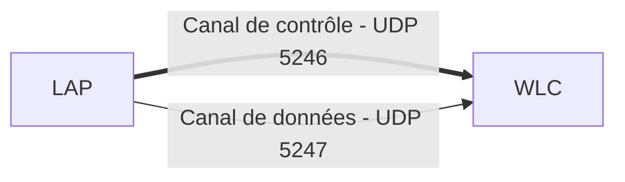
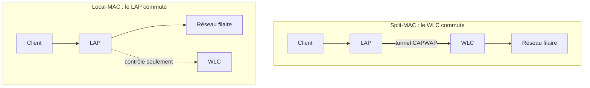

# Chapitre 4 – Le protocole CAPWAP

**Objectif :** comprendre comment un LAP et un WLC communiquent : le protocole utilisé, ses deux canaux, et la sécurité qui l'entoure.

## 4.1 Qu'est-ce que CAPWAP ?

**CAPWAP** (*Control And Provisioning of Wireless Access Points*) est le protocole qui relie un LAP à son WLC. C'est un **standard ouvert** décrit dans la **RFC 5415**. Une seconde RFC, la **RFC 5416**, décrit comment l'appliquer aux réseaux 802.11.

CAPWAP remplace un ancien protocole propriétaire de Cisco, LWAPP, dont il reprend les grandes lignes en y ajoutant, entre autres, une session **DTLS** complète.

CAPWAP sert à deux choses :

- **contrôler et configurer** le LAP : le WLC envoie les paramètres, le LAP répond et signale ses événements ;
- **transporter** le trafic des clients Wi-Fi entre le LAP et le WLC, lorsque le WLC se charge de la commutation.

## 4.2 CAPWAP dans le modèle en couches

CAPWAP est **encapsulé dans UDP**. Voici ce qu'un paquet contient, de l'extérieur vers l'intérieur :

| Couche | Contenu |
|---|---|
| Ethernet | Trame entre deux équipements voisins |
| IP | Adresse du LAP et adresse du WLC |
| UDP | Port 5246 (contrôle) ou 5247 (données) |
| DTLS | Chiffrement (voir 4.4) |
| CAPWAP | En-tête et message CAPWAP |
| Contenu | Message de contrôle, ou trame 802.11 d'un client |

C'est ce qui rend possible la jonction entre **réseaux IP différents** : comme n'importe quel trafic UDP, les paquets CAPWAP se routent.

## 4.3 Les deux canaux

CAPWAP utilise **deux canaux**, chacun sur son port UDP.

| Canal | Port UDP | Contenu | Mécanisme de vie |
|---|---|---|---|
| **Contrôle** | **5246** | Découverte, jonction, configuration, états, ordres du WLC | Messages *Echo Request / Echo Response* |
| **Données** | **5247** | Trames des clients Wi-Fi (lorsque le WLC commute) | Keepalive de données |



:::info[À retenir]
**5246 = contrôle**, **5247 = données**. Le WLC **écoute** sur ces ports ; le LAP s'y adresse. Si un pare-feu bloque l'un d'eux, la jonction peut échouer ou rester incomplète.
:::

:::note[Un canal de données qui ne sert pas toujours]
Le canal de données transporte les trames des clients **seulement** si le WLC en assure la commutation. En commutation locale, les trames des clients ne passent pas par le WLC : le canal de données sert alors surtout à maintenir le lien.
:::

## 4.4 DTLS : la sécurité du tunnel

Un LAP est souvent installé dans un faux plafond, dans un couloir : n'importe qui pourrait en débrancher un et tenter d'écouter ou de se faire passer pour lui. CAPWAP protège donc ses échanges avec **DTLS** (*Datagram Transport Layer Security*).

- DTLS est l'équivalent de **TLS** (le chiffrement de HTTPS), adapté à **UDP**.
- Il assure le **chiffrement** et l'**authentification mutuelle** : le LAP vérifie le WLC, et le WLC vérifie le LAP, grâce à des **certificats**.
- Le canal de **contrôle** est **toujours** protégé par DTLS.
- Le chiffrement du canal de **données** par DTLS est **optionnel** : on peut l'activer lorsqu'on veut protéger aussi le trafic des clients dans le tunnel, au prix d'un travail supplémentaire pour le LAP et le WLC.

:::warning[Piège : tout n'est pas chiffré]
Les messages de **découverte** (*Discovery Request* et *Discovery Response*) ne sont **pas** chiffrés : la session DTLS est établie **après** la découverte. Dans une capture réseau, vous verrez donc la découverte en clair, puis uniquement des paquets chiffrés (« DTLS application data »).
:::

## 4.5 Pourquoi des certificats ?

Pour que le LAP et le WLC puissent s'authentifier, chacun présente un certificat à l'autre.

- Le **LAP** possède un certificat installé en usine.
- Le **WLC** utilise un certificat associé à un **point de confiance** (*trustpoint*). Dans votre laboratoire, une commande génère un certificat **auto-signé** (`wireless config vwlc-ssc ...`).

Vous pouvez voir le certificat utilisé par le WLC avec :

```text
show wireless management trustpoint
```

## 4.6 Modes de fonctionnement : où se fait la commutation ?

CAPWAP prévoit deux façons de répartir le travail des fonctions « MAC » entre le LAP et le WLC.

| Mode | Qui commute les trames des clients ? | Comment circule le trafic des clients ? |
|---|---|---|
| **Split-MAC** (WLC commute) | Le WLC | Toutes les trames 802.11 sont envoyées au WLC dans le canal de données ; le LAP ne prend **aucune décision** d'acheminement |
| **Local-MAC** (LAP commute) | Le LAP | Le LAP assure l'acheminement ; le WLC agit surtout comme **gestionnaire de configuration** |



Nous ne développons pas davantage ici : le **module suivant** détaille ces deux modes, leurs effets sur les ports et les VLAN, et les autres fonctions qui peuvent être centrales ou locales.

## 4.7 Maintenir la session en vie

Une fois le LAP joint, la session doit être **surveillée** : chaque côté doit savoir si l'autre répond encore.

- Sur le canal de **contrôle**, c'est le **LAP** qui envoie périodiquement un *Echo Request* ; le WLC répond par un *Echo Response*.
- Sur le canal de **données**, un message de **keepalive** circule pour vérifier que le chemin fonctionne.

Si ces messages restent sans réponse après plusieurs tentatives, le LAP considère que le WLC est perdu et **recommence le processus de découverte** (chapitre 7).

## 4.8 Exercice : observer CAPWAP avec Wireshark

Si vous disposez d'une capture réseau prise entre un LAP et un WLC (ou sur le lien du LAP), appliquez ces filtres :

```text
udp.port == 5246
udp.port == 5247
capwap
```

Observez :

1. les paquets de **découverte** : visibles, non chiffrés ;
2. l'**établissement DTLS** (*Client Hello*, *Server Hello*…) ;
3. ensuite, uniquement des paquets chiffrés sur le port 5246.

## À retenir

- CAPWAP (RFC 5415) relie le LAP au WLC, encapsulé dans **UDP**.
- **Deux canaux** : contrôle (**UDP 5246**) et données (**UDP 5247**).
- **DTLS** chiffre le contrôle (toujours) et les données (optionnel) ; la **découverte** n'est pas chiffrée.
- Le LAP et le WLC s'authentifient par **certificats**.
- Deux répartitions du travail : **split-MAC** et **local-MAC**.
- Le LAP surveille la session par des **Echo** et des **keepalives**.

## Vérifiez votre compréhension

**Question 1.** Quel port UDP porte le canal de contrôle ? Et le canal de données ?

<details>
<summary>Voir le corrigé</summary>

Contrôle : **UDP 5246**. Données : **UDP 5247**.

</details>

**Question 2.** Pourquoi une capture montre-t-elle la découverte en clair mais pas la configuration envoyée au LAP ?

<details>
<summary>Voir le corrigé</summary>

La découverte a lieu **avant** l'établissement de la session DTLS, donc ses messages ne sont pas chiffrés. Une fois DTLS établi, les messages suivants (jonction, configuration, etc.) sont chiffrés et apparaissent comme des données DTLS.

</details>

**Question 3.** Pourquoi CAPWAP peut-il fonctionner entre un LAP et un WLC situés dans des réseaux IP différents ?

<details>
<summary>Voir le corrigé</summary>

Parce qu'il est encapsulé dans UDP/IP, donc **routable** comme tout autre trafic IP.

</details>

**Question 4.** Qui prend l'initiative des messages Echo sur le canal de contrôle ?

<details>
<summary>Voir le corrigé</summary>

Le **LAP** envoie l'*Echo Request* ; le WLC répond par un *Echo Response*.

</details>
