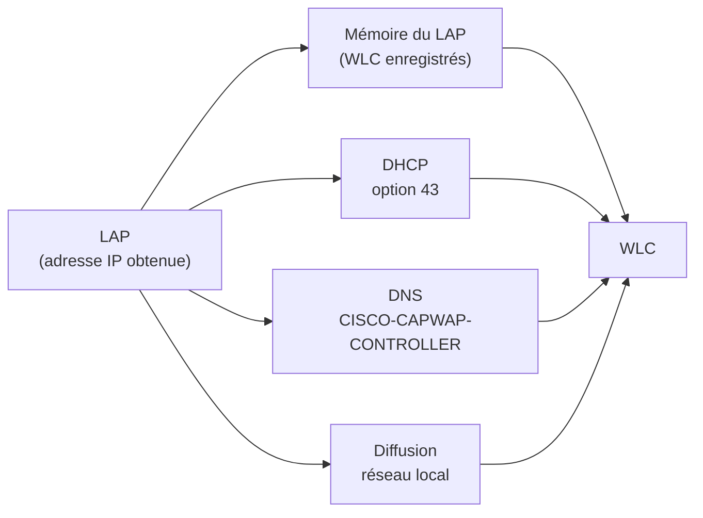

# Chapitre 5 – Découverte et sélection du WLC

**Objectif :** comprendre comment un LAP trouve le WLC auquel il doit se joindre, dans quel ordre il choisit, et savoir configurer l'**option DHCP 43**.

## 5.1 Le point de départ : un LAP qui a une adresse IP

Avant de chercher un WLC, le LAP doit être en mesure de **parler IP**. Au démarrage, il :

1. se **met sous tension** (PoE) et démarre ;
2. obtient une **configuration IP** (adresse, masque, passerelle, et souvent des options) ;
3. tente de découvrir l'adresse **MAC de sa passerelle** par une requête ARP.

:::warning[Piège : la passerelle doit répondre]
Un LAP Cisco vérifie que sa passerelle répond à l'ARP. Si elle ne répond pas, la configuration réseau est jugée **invalide** et le LAP ne pourra pas joindre le WLC. Une passerelle HSRP absente ou un mauvais VLAN suffisent à bloquer la jonction.
:::

## 5.2 Les méthodes de découverte

Pour trouver un ou plusieurs WLC, le LAP envoie des messages **Discovery Request** (sur UDP 5246). Il utilise **plusieurs méthodes** et rassemble les réponses.

| Méthode | Principe | Quand l'utiliser ? |
|---|---|---|
| **Configuration statique** (mémoire du LAP) | L'adresse du WLC est enregistrée dans le LAP (primaire, secondaire, tertiaire) | LAP déjà connu, ou placé dans un réseau particulier |
| **Option DHCP 43** | Le serveur DHCP annonce l'adresse du WLC avec l'adresse du LAP | **La méthode la plus courante** quand WLC et LAP sont dans des réseaux différents |
| **Option DHCP 52** | Idem, pour une adresse IPv6 | Réseaux IPv6 |
| **DNS** | Le LAP résout le nom `CISCO-CAPWAP-CONTROLLER.domaine` | Quand on préfère gérer l'adresse du WLC dans le DNS |
| **Diffusion (*broadcast*)** | Le LAP envoie sa demande en diffusion, un WLC du même réseau répond | Petit réseau, WLC dans le même sous-réseau |
| **Mobilité** | Le LAP réutilise des WLC connus d'un groupe de mobilité précédent | Réseaux avec plusieurs WLC |



Chaque WLC contacté répond par un **Discovery Response**.

## 5.3 La sélection : quel WLC choisir ?

Si le LAP reçoit plusieurs réponses, il choisit **dans cet ordre** :

| Priorité | Critère |
|---|---|
| 1 | **WLC primaire** enregistré dans le LAP |
| 2 | **WLC secondaire** enregistré dans le LAP |
| 3 | **WLC tertiaire** enregistré dans le LAP |
| 4 | Sinon, le WLC qui a répondu avec la **plus grande capacité disponible** (nombre de LAP qu'il peut encore accepter) |

D'autres paramètres peuvent exister au niveau du profil des LAP : WLC de secours (*backup primary / secondary*), et un mécanisme de **retour au primaire** (*AP fallback*) que le LAP applique lorsqu'il est joint à un autre WLC. Nous les revoyons au chapitre 7.

:::info[À retenir]
La **configuration statique** a toujours priorité sur les WLC découverts par DHCP, DNS ou diffusion. Ce n'est qu'en l'absence d'une configuration statique que la découverte dynamique décide.
:::

:::tip[Conséquence pratique]
Un LAP déjà utilisé ailleurs (par un autre groupe, un autre laboratoire) peut conserver l'adresse d'un **ancien WLC** en mémoire et s'obstiner à le chercher. Avant de le brancher sur votre réseau, faites-lui subir une **remise à zéro** (*factory reset*) : cela efface les WLC mémorisés.
:::

Configuration statique d'un WLC dans un LAP (en ligne de commande du LAP) :

```text
capwap ap primary-base <nom-du-wlc> <adresse-ip-du-wlc>
capwap ap secondary-base <nom-du-wlc> <adresse-ip-du-wlc>
capwap ap tertiary-base <nom-du-wlc> <adresse-ip-du-wlc>
```

## 5.4 L'option DHCP 43 en détail

L'option 43 est une option DHCP « **spécifique au fournisseur** » : son contenu dépend de l'équipement qui la lit. Pour les LAP Cisco, on y place l'adresse (ou les adresses) du WLC.

### Le format : Type – Longueur – Valeur

| Champ | Valeur | Explication |
|---|---|---|
| **Type** | `f1` | Code fixe pour les LAP Cisco (241 en décimal) |
| **Longueur** | `4 × N` | N = nombre de WLC annoncés ; chaque adresse IPv4 fait 4 octets |
| **Valeur** | Les adresses IP en hexadécimal | Une adresse après l'autre, sans séparateur |

### Exemple pas à pas : un WLC à l'adresse 10.0.99.10

1. Convertir chaque octet de l'adresse en hexadécimal :

| Octet décimal | 10 | 0 | 99 | 10 |
|---|---|---|---|---|
| Hexadécimal | `0a` | `00` | `63` | `0a` |

2. Assembler la valeur : `0a00630a`.
3. Calculer la longueur : 1 WLC × 4 octets = 4, soit `04`.
4. Assembler le tout : **type** `f1` + **longueur** `04` + **valeur** `0a00630a`.

Résultat : **`f1040a00630a`**.

Sur un serveur DHCP Cisco IOS, on l'ajoute au réservoir d'adresses :

```text
ip dhcp pool LAP-VLAN50
 network 10.0.50.0 255.255.255.0
 default-router 10.0.50.1
 option 43 hex f1040a00630a
```

### Exemple avec deux WLC : 192.168.10.5 et 192.168.10.20

| Adresse | Hexadécimal |
|---|---|
| 192.168.10.5 | `c0a80a05` |
| 192.168.10.20 | `c0a80a14` |

Longueur : 2 × 4 = 8, soit `08`. Résultat : **`f108c0a80a05c0a80a14`**.

:::tip[Convertir rapidement un nombre en hexadécimal]
Divisez par 16 : le quotient est le premier chiffre, le reste le deuxième. Par exemple 99 : 99 ÷ 16 = 6 reste 3, donc `63`. Pour 192 : 192 ÷ 16 = 12 reste 0, donc `c0` (12 = c). Les lettres : 10 = a, 11 = b, 12 = c, 13 = d, 14 = e, 15 = f.
:::

:::warning[Erreurs fréquentes avec l'option 43]
- Oublier le **type** `f1` ou la **longueur** (la valeur seule ne suffit pas).
- Se tromper dans la **longueur** : elle compte des **octets** (4 par WLC), pas des caractères hexadécimaux.
- Mettre des **virgules ou des espaces** entre les adresses selon le serveur DHCP utilisé : la valeur doit être une seule chaîne continue.
- Annoncer l'adresse du **mauvais** équipement : il faut la **WMI** du WLC.
:::

## 5.5 La découverte par DNS

Si le DHCP ne fournit pas l'option 43, le LAP interroge le DNS pour résoudre le nom :

```text
CISCO-CAPWAP-CONTROLLER.<votre-domaine>
```

Le domaine est celui que le LAP apprend par DHCP. Il suffit alors de créer, dans le DNS, un enregistrement `CISCO-CAPWAP-CONTROLLER` qui pointe vers la WMI du WLC.

## 5.6 Choisir une méthode

| Situation | Méthode recommandée |
|---|---|
| WLC et LAP dans le **même** réseau, petit laboratoire | Diffusion (aucune configuration) |
| WLC et LAP dans des réseaux **différents** (cas normal) | **Option DHCP 43** |
| Plusieurs sites, gestion centralisée des noms | DNS |
| LAP qui doit toujours rejoindre un WLC précis | Configuration statique (primaire, secondaire, tertiaire) |

## À retenir

- Le LAP doit d'abord avoir une **IP valide** et une **passerelle qui répond**.
- Méthodes : **statique**, **option 43**, **option 52**, **DNS**, **diffusion**, **mobilité**.
- Ordre de sélection : **primaire**, **secondaire**, **tertiaire**, sinon WLC ayant la **plus grande capacité disponible**.
- Option 43 : `f1` + **longueur (4 × N)** + **adresses en hexadécimal**.

## Vérifiez votre compréhension

**Question 1.** Calculez l'option 43 pour un WLC dont la WMI est **192.168.5.10**.

<details>
<summary>Voir le corrigé</summary>

192 = `c0`, 168 = `a8`, 5 = `05`, 10 = `0a`. Valeur : `c0a8050a`. Longueur : `04`. Résultat : **`f104c0a8050a`**.

</details>

**Question 2.** Calculez l'option 43 pour deux WLC : **192.168.5.10** et **192.168.5.11**.

<details>
<summary>Voir le corrigé</summary>

192.168.5.10 = `c0a8050a` ; 192.168.5.11 = `c0a8050b`. Longueur : 2 × 4 = 8, soit `08`. Résultat : **`f108c0a8050ac0a8050b`**.

</details>

**Question 3.** Un LAP reçoit en DHCP l'option 43 d'un WLC « B », mais il se joint pourtant à un WLC « A » qu'il connaissait déjà. Quelle est l'explication la plus probable ?

<details>
<summary>Voir le corrigé</summary>

Le WLC « A » est probablement enregistré dans la **mémoire du LAP** comme primaire (configuration statique). La configuration statique est prioritaire sur la découverte par DHCP. Solution : effacer la configuration du LAP (*factory reset*) ou modifier ses WLC enregistrés.

</details>

**Question 4.** Un LAP est dans le VLAN 50 ; la passerelle HSRP du VLAN 50 est arrêtée. Pourquoi le LAP ne se joint-il pas, même si le WLC est parfaitement configuré ?

<details>
<summary>Voir le corrigé</summary>

Le LAP tente de résoudre l'adresse MAC de sa passerelle par ARP. Sans réponse, il juge sa configuration réseau invalide et n'envoie pas de demande de découverte utile. Il ne peut donc pas joindre le WLC, même si celui-ci fonctionne.

</details>

**Question 5.** Dans quel cas la découverte par **diffusion** est-elle suffisante ?

<details>
<summary>Voir le corrigé</summary>

Lorsque le WLC se trouve dans le **même réseau (domaine de diffusion)** que le LAP. La diffusion n'est pas routée : si le WLC est dans un autre réseau, il faut recourir à l'option 43, au DNS ou à la configuration statique.

</details>
