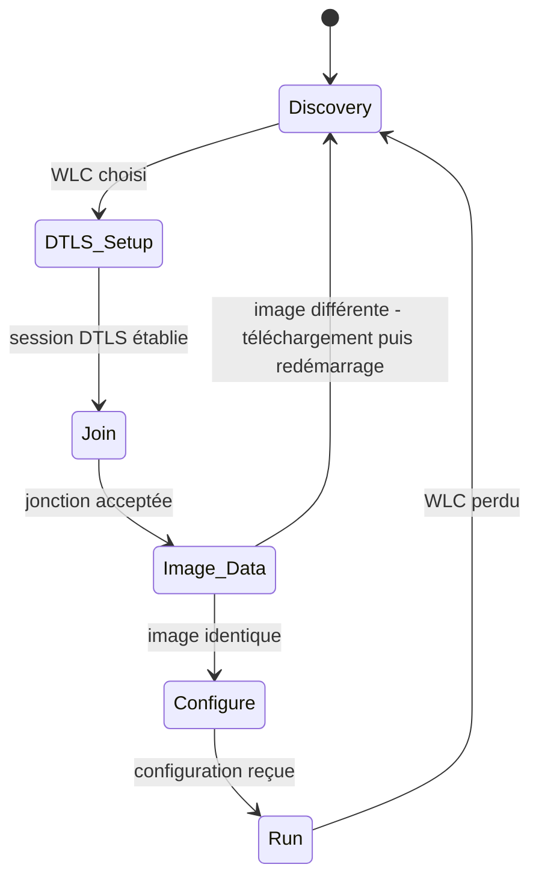
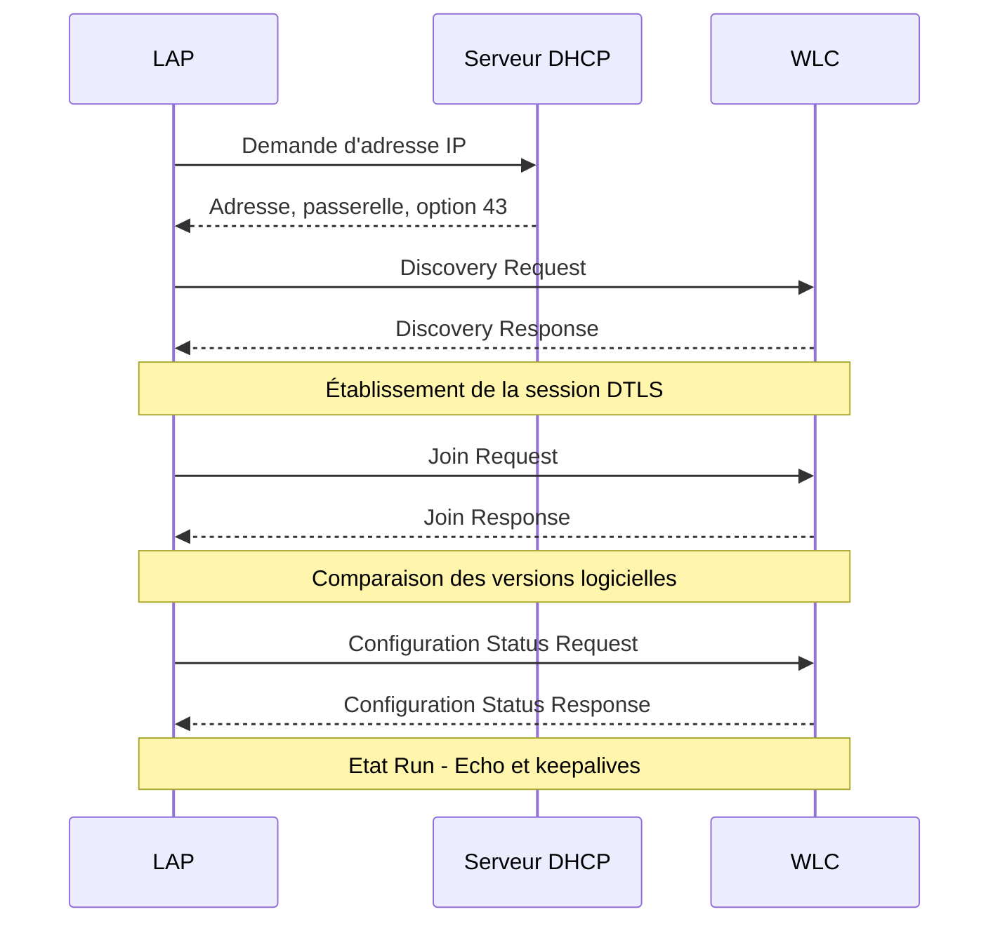

# Chapitre 6 – La jonction d'un LAP, étape par étape

**Objectif :** suivre, message par message, ce qui se passe entre un LAP et un WLC depuis la découverte jusqu'au fonctionnement normal.

## 6.1 Vue d'ensemble : une machine à états

Un LAP traverse une série d'**états**. À chaque état correspond une phase de la jonction et un échange précis de messages.



| # | État | Ce qui se passe |
|---|---|---|
| 1 | **Discovery** | Le LAP cherche et choisit un WLC |
| 2 | **DTLS Setup** | Création du tunnel chiffré du canal de contrôle |
| 3 | **Join** | Le LAP demande à se joindre, le WLC accepte |
| 4 | **Image Data** | Comparaison des versions logicielles, mise à jour au besoin |
| 5 | **Configure** | Échange de la configuration |
| 6 | **Run** | Le LAP est opérationnel |

## 6.2 Le déroulement complet



## 6.3 État 1 – Discovery

Le LAP applique le chapitre 5 : il envoie des *Discovery Request*, reçoit des *Discovery Response*, puis choisit un WLC selon l'ordre de sélection.

Dans la console d'un LAP, cet état s'affiche, par exemple :

```text
CAPWAP State: Discovery
```

La ligne suivante indique souvent la **source** de l'adresse du WLC (configuration statique, DHCP, DNS, diffusion).

## 6.4 État 2 – DTLS Setup

Le LAP a choisi un WLC. Les deux équipements construisent maintenant un **tunnel chiffré** pour le canal de contrôle. L'échange se déroule ainsi :

| Étape | Message | Rôle |
|---|---|---|
| 1 | LAP → WLC : **ClientHello** | Le LAP demande une session |
| 2 | WLC → LAP : **HelloVerifyRequest** (avec un *cookie*) | Le WLC s'assure que le LAP est bien joignable à son adresse (protection contre les fausses demandes) |
| 3 | LAP → WLC : **ClientHello** (avec le cookie) | Le LAP confirme |
| 4 | WLC → LAP : **ServerHello**, **Certificate**, **ServerKeyExchange**, **CertificateRequest**, **ServerHelloDone** | Le WLC présente son certificat et demande celui du LAP |
| 5 | LAP → WLC : **Certificate**, **ClientKeyExchange**, **CertificateVerify**, **ChangeCipherSpec** | Le LAP présente son certificat et passe en mode chiffré |
| 6 | WLC → LAP : **ChangeCipherSpec** | Le WLC passe en mode chiffré : le tunnel est établi |

**À partir de ce moment, tous les messages de contrôle sont chiffrés.**

:::note[Les certificats, indispensables]
Chacun valide le certificat de l'autre. Si l'un des certificats est **invalide, expiré, non fiable ou si l'heure d'un équipement est très fausse**, la session DTLS **échoue** et la jonction s'arrête ici. C'est une cause classique de LAP qui « tourne en boucle » : il recommence la découverte, tente DTLS, échoue, et recommence.
:::

## 6.5 État 3 – Join

Dans le tunnel chiffré :

1. le LAP envoie un **Join Request** : il se présente (modèle, adresse MAC, version logicielle, capacités) ;
2. le WLC répond par un **Join Response**, avec un **code de résultat**.

Un code de résultat **0** signifie que la jonction est **acceptée**. Un autre code signale un refus, avec une raison précise.

## 6.6 État 4 – Image Data

Le LAP compare la **version logicielle** qu'il exécute avec celle du WLC.

| Cas | Conséquence |
|---|---|
| Versions **identiques** | Le LAP passe à l'état suivant |
| Versions **différentes** | Le LAP **télécharge** l'image depuis le WLC, l'installe sur sa partition inactive, bascule dessus et **redémarre**. Tout le processus recommence à l'étape 1 |

:::tip[Ne soyez pas surpris]
Un LAP neuf (ou récupéré d'un autre réseau) qui se joint la première fois **redémarre souvent une fois** pour se mettre à jour. Cela peut prendre plusieurs minutes. Le comportement est normal.
:::

## 6.7 État 5 – Configure

Le LAP envoie un *Configuration Status Request* : il indique à quoi ressemble sa configuration actuelle. Le WLC répond par un *Configuration Status Response*, et peut **conserver** ou **remplacer** cette configuration. C'est à cette étape que le LAP reçoit :

- son **nom**, son emplacement (*location*) ;
- ses **réglages radio** ;

Les **étiquettes** (*tags*) sont aussi appliquées au LAP en fin de jonction (états Configure et Run) : un LAP à qui l'administrateur n'a rien attribué reçoit les étiquettes **par défaut** (par exemple `default-policy-tag`).

Les *tags* et les profils sont le sujet du module suivant.

## 6.8 État 6 – Run

Le LAP est **opérationnel**. Il apparaît dans le tableau de bord du WLC, diffuse les SSID qui lui sont associés et sert les clients.

Un LAP à qui on a attribué une configuration de site distant (profil **Flex**) passe automatiquement en **mode FlexConnect** : il peut alors continuer à fonctionner même si le contact avec le WLC est perdu. Ce sera approfondi dans le module sur la commutation centrale et locale.

## 6.9 Où voir chaque étape ?

| Où | Ce qu'on y voit |
|---|---|
| **Console du LAP** | Messages `CAPWAP State: ...`, adresses du WLC, erreurs |
| **Tableau de bord du WLC** | Nombre de LAP joints |
| **WLC, `show ap summary`** | Liste des LAP joints, noms, modèles |
| **Capture réseau** | Découverte en clair, puis DTLS, puis données chiffrées |

## À retenir

- La jonction est une suite de **6 états** : Discovery, DTLS Setup, Join, Image Data, Configure, Run.
- **DTLS** exige des **certificats valides** des deux côtés.
- Un **code de résultat 0** au Join signifie acceptation.
- Si les **versions diffèrent**, le LAP télécharge l'image, **redémarre** et reprend du début.
- À la fin de la jonction (**Configure** et **Run**), le LAP reçoit sa configuration : nom, réglages radio et **tags**.

## Vérifiez votre compréhension

**Question 1.** Dans quel ordre le LAP traverse-t-il les états ?

<details>
<summary>Voir le corrigé</summary>

Discovery, DTLS Setup, Join, Image Data, Configure, Run.

</details>

**Question 2.** Un LAP recommence sans cesse la découverte et n'arrive jamais à l'état Join. À quelle étape faut-il d'abord soupçonner un problème ?

<details>
<summary>Voir le corrigé</summary>

À l'étape **DTLS Setup** : problème de certificat (invalide, expiré, non fiable) ou d'heure très erronée, ou encore des paquets UDP 5246 qui ne passent pas correctement dans les deux sens. Les étapes précédentes (réception d'une réponse de découverte) ont réussi puisque le LAP a pu choisir un WLC.

</details>

**Question 3.** Un LAP vient de se joindre pour la première fois et redémarre. Faut-il s'inquiéter ?

<details>
<summary>Voir le corrigé</summary>

Non. Si la version logicielle du LAP diffère de celle du WLC, le LAP télécharge l'image du WLC, redémarre, puis recommence le processus. C'est le comportement attendu.

</details>

**Question 4.** À quelle étape le LAP reçoit-il sa configuration et ses *tags* ?

<details>
<summary>Voir le corrigé</summary>

En fin de jonction : à l'état **Configure** (échange *Configuration Status Request / Response*), puis à l'état **Run**, où le WLC lui attribue ses *tags* (les *tags* par défaut si rien n'est prévu).

</details>
