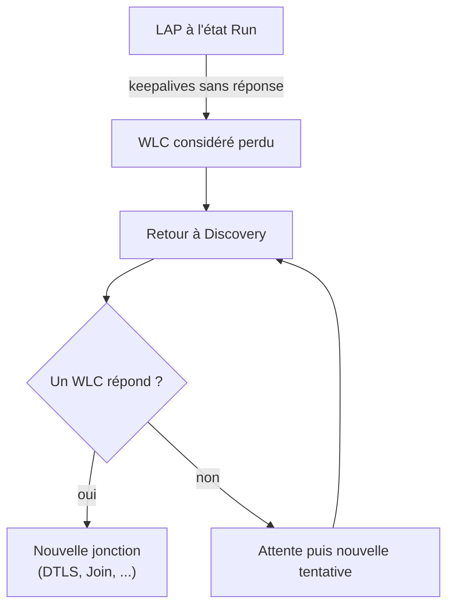

# Chapitre 7 – Fonctionnement normal et résilience

**Objectif :** comprendre ce qui maintient la session entre le LAP et le WLC, et ce qui se passe quand le WLC devient inaccessible.

## 7.1 Une session qu'on surveille

Une fois le LAP à l'état **Run**, la relation avec le WLC n'est pas « terminée » : elle est **entretenue**. Deux mécanismes s'en chargent (chapitre 4).

| Canal | Mécanisme | Qui prend l'initiative ? |
|---|---|---|
| Contrôle (UDP 5246) | *Echo Request / Echo Response* | Le **LAP** |
| Données (UDP 5247) | Keepalive de données | Les deux côtés vérifient le chemin |

L'objectif est de répondre rapidement à la question : « l'autre côté est-il toujours là ? ». Sans réponse après plusieurs tentatives, la session est considérée comme **rompue**.

:::note[Valeurs des temporisations]
Les intervalles et le nombre d'essais précis dépendent de la version logicielle et de la configuration (profil des LAP). Consultez la documentation de votre version si vous devez les connaître ou les modifier.
:::

## 7.2 Quand le WLC devient inaccessible

Lorsque le LAP conclut que le WLC est perdu, il **repart au début** : il retourne à l'état **Discovery** et cherche un WLC, en suivant l'ordre de sélection du chapitre 5.

Ce que cela signifie pour les **clients Wi-Fi** dépend du mode du LAP :

| Mode du LAP | Effet sur les clients quand le WLC est perdu |
|---|---|
| **Local** (le WLC commute) | Les clients sont **déconnectés** : le LAP ne peut rien faire sans le WLC |
| **FlexConnect** (commutation locale) | Les clients **peuvent rester connectés** dans certains cas (selon que l'authentification et l'association sont aussi locales). À détailler dans le module suivant |

## 7.3 Plan de secours : primaire, secondaire, tertiaire

Pour éviter l'arrêt total si un WLC tombe en panne, on prévoit **plusieurs WLC** et on indique à chaque LAP dans quel ordre les essayer.

| Niveau | Où se configure ? | Usage |
|---|---|---|
| **Primaire**, **secondaire**, **tertiaire** | Par LAP | Ordre de préférence des WLC à joindre |
| **Secours primaire** et **secours secondaire** | Dans le profil commun des LAP | Plan B partagé par tous les LAP d'un site |

Avec la fonction **AP Fallback**, un LAP qui est actuellement joint à un WLC de secours **revient automatiquement** à son WLC primaire dès que celui-ci est de nouveau disponible.

:::info[À retenir]
La sélection du WLC est **déterministe** : le LAP essaie d'abord le primaire, puis le secondaire, puis le tertiaire, puis, seulement après, les WLC de secours ou le WLC avec la plus grande capacité disponible.
:::

## 7.4 Redondance du WLC lui-même

Pour qu'un site n'ait pas **un seul point de défaillance**, on déploie souvent **deux WLC** : soit comme deux contrôleurs indépendants (on utilise alors primaire et secondaire), soit comme une **paire de haute disponibilité** qui apparaît comme un seul contrôleur et prend le relais sans que les LAP aient à refaire la jonction. Ce dernier cas dépasse le cadre de ce module : retenez qu'il existe.

## 7.5 Mises à jour logicielles

Lorsque vous mettez à jour le WLC, les LAP doivent exécuter une **version compatible**. C'est le mécanisme de l'état **Image Data** (chapitre 6) qui s'en charge :

1. le WLC est mis à jour ;
2. chaque LAP qui se joint compare sa version avec celle du WLC ;
3. si elle est différente, il télécharge la nouvelle image et redémarre.

:::warning[À planifier]
Une mise à jour de grande ampleur déclenche le redémarrage de nombreux LAP. Prévoyez-la en dehors des heures d'utilisation, et vérifiez que le trafic de téléchargement (de l'image du WLC vers les LAP) est bien permis par le réseau.
:::

## 7.6 Comment savoir si tout va bien ?

| Où regarder | Ce qu'on vérifie |
|---|---|
| Tableau de bord du WLC | Le nombre de LAP joints correspond au nombre attendu |
| Monitoring > Wireless > AP Statistics | Chaque LAP est présent, avec son nom et son état |
| Détail du LAP (Configuration > Wireless > Access Points) | Temps de fonctionnement du LAP et temps depuis la jonction (les libellés varient selon la version) |

Interprétation du temps de fonctionnement :

- si le temps de fonctionnement **et** le temps depuis la jonction sont tous deux courts, le LAP a **redémarré** ;
- si le temps de fonctionnement est élevé mais le temps depuis la jonction est court, c'est la **session CAPWAP** qui a été rompue puis rétablie (LAP qui se déconnecte et revient).

## À retenir

- Le LAP **surveille** sa session : Echo (contrôle) et keepalive (données).
- WLC perdu : le LAP **retourne à Discovery** ; en mode **local**, les clients sont déconnectés.
- **Primaire / secondaire / tertiaire** fixent l'ordre des WLC ; **AP Fallback** ramène le LAP au primaire.
- Un WLC de **secours** (ou une paire de haute disponibilité) évite le point de défaillance unique.

## Vérifiez votre compréhension

**Question 1.** Que fait un LAP qui ne reçoit plus de réponse à ses messages Echo ?

Voir le corrigé

Après plusieurs tentatives sans réponse, il considère le WLC perdu et **retourne à l'état Discovery** pour chercher un WLC.

**Question 2.** Pourquoi les clients d'un LAP en mode local perdent-ils la connexion si le WLC tombe en panne ?

Voir le corrigé

Parce que, dans ce mode, le WLC assure la commutation (et d'autres fonctions) pour les clients. Sans le WLC, le LAP ne peut pas acheminer leur trafic.

**Question 3.** Quel est l'intérêt d'AP Fallback ?

Voir le corrigé

Lorsqu'un LAP a dû se joindre à un WLC de secours, AP Fallback le fait **revenir** à son WLC primaire dès que ce dernier est rétabli. On retrouve ainsi la répartition prévue des LAP entre les WLC.

**Question 4.** Up Time élevé mais temps depuis la jonction (*association uptime*) faible : que s'est-il passé ?

Voir le corrigé

Le LAP n'a **pas redémarré** : c'est la **session CAPWAP** qui a été rompue puis rétablie (par exemple perte de keepalives, changement de configuration).

