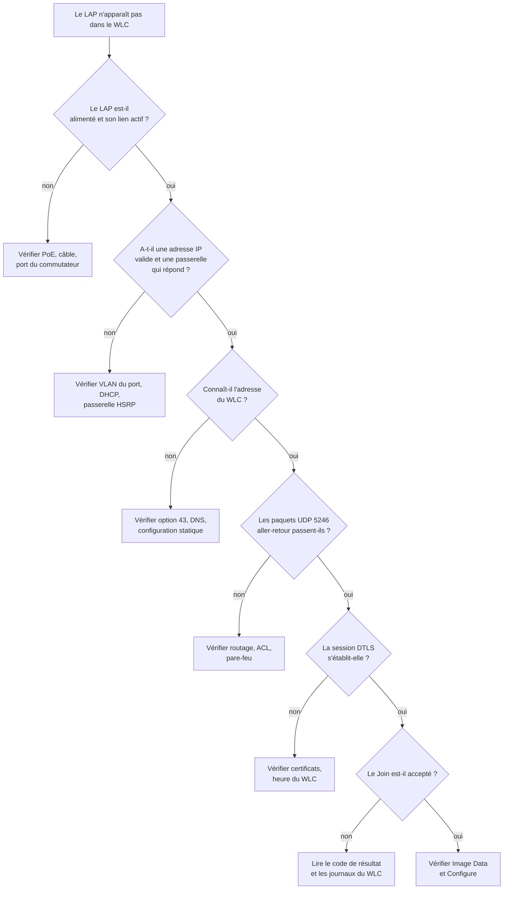

# Chapitre 8 – Dépannage de la jonction

**Objectif :** diagnostiquer méthodiquement un LAP qui ne se joint pas au WLC, en utilisant ce que vous savez de l'ordre des étapes.

## 8.1 Le principe : remonter l'ordre des étapes

Les étapes de la jonction sont **dépendantes** les unes des autres : si l'une échoue, les suivantes ne peuvent pas se produire. Votre méthode consiste donc à identifier **la dernière étape réussie**. Le problème se trouve à l'étape **suivante**.



## 8.2 Symptômes, causes probables et vérifications

| # | Symptôme | Cause probable | Où vérifier |
|---|---|---|---|
| 1 | Le LAP n'a **pas d'adresse IP** | Mauvais VLAN sur le port, DHCP absent ou épuisé, relais DHCP manquant | Commutateur d'accès (`show interfaces status`, VLAN du port), DHCP (`show ip dhcp binding`) |
| 2 | Le LAP a une IP mais **ne joint pas** | La passerelle ne répond pas à l'ARP | `show standby brief` sur la distribution, accessibilité de la passerelle |
| 3 | Le LAP **ne sait pas où chercher** | Option 43 absente ou mal calculée, pas d'enregistrement DNS | Console du LAP (adresse du WLC annoncée), configuration DHCP |
| 4 | Le LAP envoie des découvertes **sans réponse** | UDP 5246 filtré, mauvais routage, WLC injoignable | `ping` du WLC depuis la distribution, ACL, pare-feu |
| 5 | La découverte réussit mais le LAP **recommence en boucle** | Échec DTLS : certificat invalide ou heure erronée | `show wireless management trustpoint`, heure du WLC |
| 6 | Le LAP se joint à un **mauvais WLC** | Ancienne configuration statique mémorisée dans le LAP | Remise à zéro du LAP, WLC primaire enregistré |
| 7 | Le LAP **redémarre** à chaque jonction | Mise à jour logicielle en cours, ou version qui ne se stabilise pas | Console du LAP, comparaison des versions |
| 8 | Le Join est **refusé** | Contrainte du WLC (capacité maximale, domaine réglementaire du LAP incompatible avec le pays configuré, etc.) | Journaux du WLC, `show wireless stats ap join summary` |

:::warning[Le domaine réglementaire]
Un LAP est vendu pour une région (domaine réglementaire). Le WLC est configuré avec un **pays** (dans le laboratoire : `wireless country CA`). Un LAP dont le domaine réglementaire n'est pas compatible avec le pays configuré peut être refusé. Vérifiez la référence du LAP.
:::

## 8.3 Les commandes à connaître

### Sur le WLC

| Commande | Ce qu'elle montre |
|---|---|
| `show ap summary` | Les LAP joints, leur nom, leur modèle |
| `show ap uptime` | Temps de fonctionnement du LAP et temps depuis la jonction |
| `show wireless stats ap discovery` | Statistiques des découvertes reçues |
| `show wireless stats ap join summary` | Résumé des jonctions : **phase** et **cause** de la dernière rupture |
| `show wireless stats ap mac <mac-radio> join detailed` | Détail pour un LAP donné : compteurs par phase (découverte, DTLS, join, configuration, données), dernier redémarrage, dernière déconnexion |
| `show wireless stats ap mac <mac-radio> discovery detailed` | Détail des découvertes pour un LAP |
| `show wireless dtls connections` | État des sessions DTLS (contrôle et données) |
| `show wireless management trustpoint` | Type de certificat utilisé par le WLC |
| `show wireless certification config` | Version de DTLS et suites de chiffrement |
| `show wireless stats ap history` | Historique des événements des LAP |

:::tip[Un bon réflexe]
Commencez par `show wireless stats ap join summary` : il indique en **quelle phase** la jonction échoue (découverte, DTLS, join, configuration, données DTLS), ce qui vous dit d'emblée où chercher.
:::

### Sur le commutateur et la distribution

| Commande | Ce qu'elle montre |
|---|---|
| `show interfaces status` | État du port du LAP |
| `show interfaces trunk` | VLAN autorisés et VLAN natif (si le LAP est en trunk) |
| `show standby brief` | État HSRP des passerelles |
| `show ip dhcp binding` | Adresses attribuées aux LAP |
| `show ip route` | Route vers le réseau du WLC |

### Sur le LAP (console ou SSH)

Pour les LAP de génération récente, on peut activer des traces sur le LAP :

```text
debug capwap client events
debug capwap client error
debug dtls client error
debug dtls client event
```

Si vous êtes connecté par SSH, activez aussi `terminal monitor` : sans lui, les messages ne s'affichent pas.

:::warning[Les traces de débogage]
Elles sont verbeuses et se destinent à un diagnostic ciblé. Activez-les pour un LAP précis, pendant un test court, puis désactivez-les.
:::

## 8.4 Scénarios guidés

Pour chaque scénario, essayez de trouver la cause **avant** d'ouvrir le corrigé.

### Scénario A – Le LAP reste muet

Vous branchez un LAP sur un port du commutateur d'accès. Après dix minutes, il n'apparaît pas dans le WLC. Vous constatez que le port est actif. La table des liaisons du DHCP ne contient pas de bail pour ce LAP.

<details>
<summary>Voir le corrigé</summary>

Le LAP n'a pas obtenu d'adresse : on est **avant** l'étape de découverte. Pistes : le port est dans le **mauvais VLAN** (pas celui des LAP), le serveur DHCP ne dessert pas ce VLAN (relais `ip helper-address` manquant), ou l'étendue est **épuisée**. On vérifie d'abord le VLAN du port, puis le DHCP.

</details>

### Scénario B – Une IP mais aucune jonction

Le LAP a bien une adresse (10.0.50.21). Sa passerelle (10.0.50.1) ne répond pas au ping. Le WLC est parfaitement configuré.

<details>
<summary>Voir le corrigé</summary>

Le LAP vérifie sa passerelle par ARP. Sans réponse, il ne peut pas poursuivre. Il faut rétablir la passerelle : état de **HSRP** sur la distribution (`show standby brief`), état de l'interface `Vlan50`, VLAN 50 autorisé sur les liens entre l'accès et la distribution.

</details>

### Scénario C – Le LAP cherche sans trouver

Le LAP est dans le VLAN 50 et son WLC dans le VLAN 99. La console du LAP affiche des demandes de découverte répétées, sans réponse. Dans le DHCP, vous avez écrit l'option 43 `f1040a0063a0`.

<details>
<summary>Voir le corrigé</summary>

La valeur de l'option 43 est **fausse** : l'adresse du WLC (10.0.99.10) donne `0a00630a`, soit **`f1040a00630a`**. La valeur saisie comporte une erreur sur les derniers octets : le LAP interroge une adresse qui n'est pas celle du WLC, donc personne ne répond. La correction est de recalculer l'option octet par octet.

</details>

### Scénario D – Le LAP tourne en rond

La découverte réussit : le LAP voit le WLC. Mais il recommence sans cesse, sans jamais atteindre l'état Join. Le WLC vient d'être installé et son horloge indique l'année 2000.

<details>
<summary>Voir le corrigé</summary>

L'échec se situe à l'étape **DTLS Setup** : les certificats sont vérifiés, notamment leur **période de validité**. Avec une horloge du WLC très erronée, le certificat paraît invalide. Il faut **régler l'heure** du WLC (idéalement par NTP), puis regénérer ou vérifier le certificat (`show wireless management trustpoint`).

</details>

### Scénario E – Le mauvais WLC

Le LAP provient d'un autre laboratoire. Même si vous avez correctement configuré l'option 43 vers votre WLC, il se joint à l'ancien WLC de l'autre équipe.

<details>
<summary>Voir le corrigé</summary>

Une **configuration statique** (WLC primaire) est restée mémorisée dans le LAP : elle est prioritaire sur l'option 43. Solution : **remise à zéro** du LAP (*factory reset*), qui efface les WLC mémorisés.

</details>

## À retenir

- Identifiez **la dernière étape réussie** : la panne est à l'étape suivante.
- Ordre de vérification : alimentation, **IP et passerelle**, **adresse du WLC**, **UDP 5246**, **DTLS**, **Join**, **image et configuration**.
- `show wireless stats ap join summary` indique **en quelle phase** la jonction échoue.
- Les causes les plus fréquentes : **VLAN/DHCP**, **passerelle**, **option 43**, **filtrage UDP**, **certificat/heure**, **configuration statique résiduelle**.

## Vérifiez votre compréhension

**Question 1.** Quelle commande indique la phase où la jonction échoue ?

<details>
<summary>Voir le corrigé</summary>

`show wireless stats ap join summary` (et, pour un LAP précis, `show wireless stats ap mac <mac-radio> join detailed`).

</details>

**Question 2.** Pourquoi vérifier la passerelle avant de regarder la configuration du WLC ?

<details>
<summary>Voir le corrigé</summary>

Parce que les étapes sont dépendantes : sans passerelle fonctionnelle, le LAP ne peut même pas envoyer de découverte utile. Inutile d'examiner le WLC tant que le LAP n'a pas de configuration réseau valide.

</details>

**Question 3.** Le LAP reçoit une réponse de découverte mais n'arrive pas au Join. Quelles sont les causes les plus plausibles ?

<details>
<summary>Voir le corrigé</summary>

Un échec de la session **DTLS** : certificat invalide ou non fiable, heure erronée sur le WLC, ou paquets UDP 5246 qui ne passent pas correctement dans les deux sens (ACL, pare-feu).

</details>
