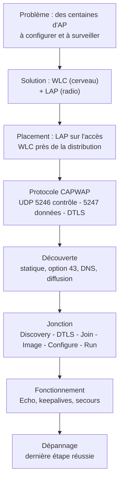

# Chapitre 9 – Synthèse et exercices

## 9.1 Le module en une page



## 9.2 Les chiffres et les noms à connaître

| À retenir | Valeur |
|---|---|
| Protocole entre LAP et WLC | **CAPWAP** (RFC 5415) |
| Port du canal de contrôle | **UDP 5246** |
| Port du canal de données | **UDP 5247** |
| Chiffrement | **DTLS** (contrôle toujours, données en option) |
| Option DHCP de découverte | **43** (IPv4), **52** (IPv6) |
| Code de sous-option 43 pour LAP Cisco | **f1** |
| Nom DNS de découverte | **CISCO-CAPWAP-CONTROLLER.domaine** |
| Interface de gestion du WLC | **WMI** |
| Ordre de sélection | primaire, secondaire, tertiaire, puis plus grande capacité |
| États de la jonction | **Discovery, DTLS Setup, Join, Image Data, Configure, Run** |

## 9.3 Tableau des idées fausses fréquentes

| Idée fausse | Réalité |
|---|---|
| « Le LAP doit être dans le même réseau que le WLC » | Non : CAPWAP est routable, le LAP et le WLC peuvent être dans des réseaux IP différents |
| « Le WLC participe à STP » | Non : c'est un équipement terminal |
| « Tout le trafic CAPWAP est chiffré » | La **découverte** ne l'est pas |
| « Le LAP garde sa configuration pour toujours » | Il la reçoit du WLC (sauf cas particulier de FlexConnect) |
| « L'option 43 contient simplement l'adresse IP » | Elle contient **type + longueur + adresses**, en hexadécimal |
| « Un LAP joint toujours le dernier WLC annoncé par DHCP » | Une **configuration statique** mémorisée est prioritaire |

## 9.4 Exercices de synthèse

**Exercice 1 – Schéma.** Dessinez de mémoire la topologie du module : distribution (DS1, DS2), accès, WLC, LAP, VLAN 50 et VLAN 99. Indiquez les passerelles HSRP.

<details>
<summary>Voir le corrigé</summary>

Vérifiez que votre schéma contient : deux commutateurs de distribution reliés entre eux ; un commutateur d'accès raccordé aux deux ; le LAP sur l'accès (VLAN 50, passerelle 10.0.50.1 virtuelle HSRP) ; le WLC près de la distribution (VLAN 99, WMI 10.0.99.10, passerelle 10.0.99.1). Reportez-vous au schéma de la page de présentation.

</details>

**Exercice 2 – Calcul.** Calculez l'option 43 pour trois WLC : 172.16.1.10, 172.16.1.11, 172.16.1.12.

<details>
<summary>Voir le corrigé</summary>

172 = `ac`, 16 = `10`, 1 = `01`, 10 = `0a`, 11 = `0b`, 12 = `0c`. Valeur : `ac10010a ac10010b ac10010c`. Longueur : 3 × 4 = 12, soit `0c`. Résultat : **`f10cac10010aac10010bac10010c`**.

</details>

**Exercice 3 – Ordre des états.** Mettez en ordre : *Run*, *Join*, *DTLS Setup*, *Configure*, *Discovery*, *Image Data*.

<details>
<summary>Voir le corrigé</summary>

Discovery, DTLS Setup, Join, Image Data, Configure, Run.

</details>

**Exercice 4 – Port.** Écrivez la configuration d'un port d'accès pour un LAP en commutation centrale (VLAN 50), puis celle d'un port trunk pour un LAP en commutation locale (VLAN 50 natif, clients dans les VLAN 110 et 120).

<details>
<summary>Voir le corrigé</summary>

Port d'accès :

```text
interface GigabitEthernet1/0/10
 switchport mode access
 switchport access vlan 50
 spanning-tree portfast
```

Port trunk :

```text
interface GigabitEthernet1/0/10
 switchport mode trunk
 switchport trunk native vlan 50
 switchport trunk allowed vlan 50,110,120
 spanning-tree portfast trunk
```

</details>

**Exercice 5 – Diagnostic.** Un LAP est branché ; il a une IP et sa passerelle répond. Une capture réseau montre qu'il envoie des demandes de découverte en boucle, sans réponse. L'option 43 est correcte. Quelles vérifications faites-vous ensuite ?

<details>
<summary>Voir le corrigé</summary>

Le problème se situe entre la connaissance de l'adresse du WLC et la réponse. Vérifier : l'**accessibilité** du WLC depuis le réseau du LAP (routage, `ping`), le filtrage de **UDP 5246** (ACL, pare-feu) dans les deux sens, l'état du WLC (WMI active, interface de gestion correcte). Ensuite, regarder les statistiques de découverte dans l'interface web du WLC (*Monitoring > Wireless > AP Statistics*) pour savoir s'il reçoit les demandes.

</details>

**Exercice 6 – Justification.** Expliquez à un collègue pourquoi un LAP peut se joindre à un WLC situé dans un autre réseau IP, mais pas si un pare-feu bloque UDP 5246.

<details>
<summary>Voir le corrigé</summary>

CAPWAP est encapsulé dans UDP/IP : il est donc routable et franchit les routeurs comme tout autre trafic. Mais il utilise des ports précis (5246 pour le contrôle, 5247 pour les données). Si un filtre bloque le port 5246, la découverte et la session de contrôle ne peuvent pas s'établir.

</details>

## 9.5 Mise en pratique

Ce module se met en pratique par la construction d'un petit réseau sans fil : installation du WLC, configuration réseau, connexion d'un LAP et vérification de sa jonction. Les **laboratoires associés** seront précisés par votre enseignant.

Pour vous exercer seul, vous pouvez en tout cas :

1. **Dessiner** la topologie du module et la compléter avec vos propres adresses ;
2. **Calculer** l'option 43 correspondant à votre WLC ;
3. **Prédire** ce que vous devriez voir dans la capture réseau à chaque étape ;
4. **Capturer** le trafic CAPWAP (filtre `udp.port == 5246`) et repérer la découverte, puis les paquets chiffrés ;
5. **Provoquer** volontairement une panne (mauvais VLAN, mauvaise option 43) et retrouver la cause avec la méthode du chapitre 8.

## 9.6 Pour la suite

Vous savez maintenant comment un LAP **trouve** son WLC et **s'y joint**. Il reste à voir :

- comment les profils et les *tags* décrivent ce que fait chaque LAP ;
- ce qui se passe pour le **trafic des clients** : commutation **centrale** ou **locale**, avec leurs effets sur les ports, les trunks et les VLAN ;
- comment les clients **s'authentifient** (802.1X, RADIUS).
