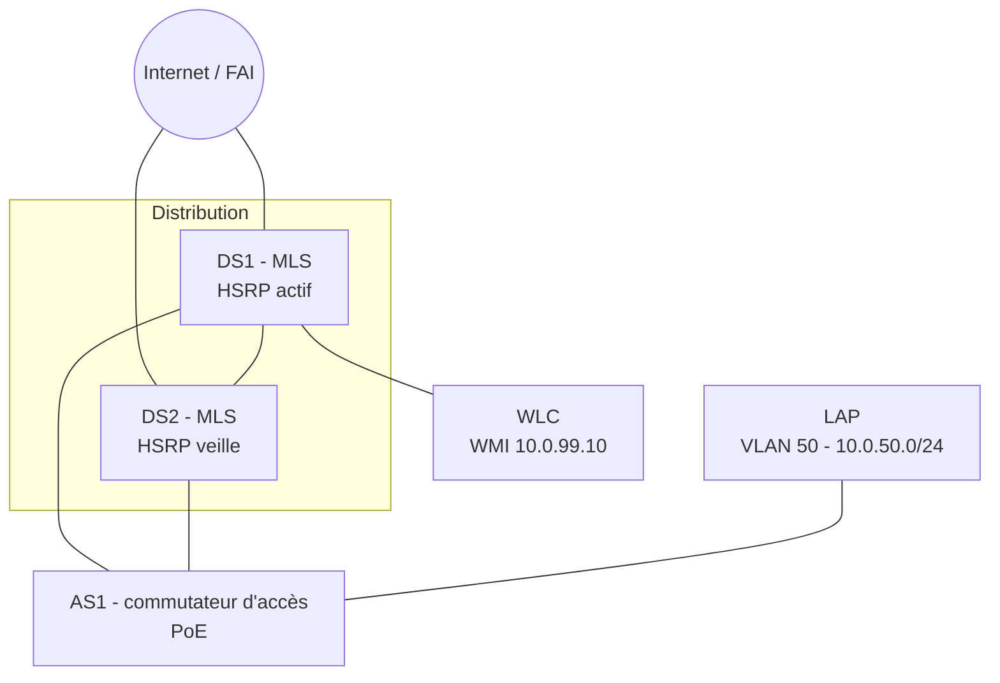

# Module 1 – Architecture WLC/LAP et jonction CAPWAP

Bienvenue dans le premier module consacré aux réseaux sans fil **centralisés**. Il est écrit pour être suivi **seul**, à votre rythme : chaque chapitre explique la matière, donne des exemples, et se termine par des questions avec corrigé.

## Ce que vous saurez faire à la fin

1. Expliquer pourquoi les entreprises utilisent un **contrôleur sans fil (WLC)** plutôt que des points d'accès configurés un par un.
2. Distinguer un point d'accès **autonome** d'un point d'accès **léger (LAP)**.
3. Situer le WLC et les LAP dans une architecture **accès-distribution** que vous connaissez déjà : VLAN, trunks, LACP, HSRP.
4. Décrire le protocole **CAPWAP** : ses deux canaux, ses ports UDP et le rôle de DTLS.
5. Énumérer les **méthodes de découverte** d'un WLC par un LAP et l'**ordre de sélection**.
6. Calculer une valeur d'**option DHCP 43** pour annoncer un WLC aux LAP.
7. Suivre, étape par étape, la **jonction** d'un LAP à un WLC (Discovery, DTLS, Join, Image Data, Configure, Run).
8. **Dépanner** un LAP qui ne se joint pas au WLC, avec une méthode et les bonnes commandes.

## Ce qu'il faut déjà connaître

| Notion | Où vous l'avez vue |
|---|---|
| Topologie accès-distribution | Cours de commutation |
| VLAN, trunk 802.1Q, VLAN natif | Cours de commutation |
| Routage inter-VLAN (router-on-a-stick, MLS avec SVI) | Cours de commutation |
| LACP, STP, HSRP | Cours de commutation |
| DHCP et ses options | Cours de services réseau |
| Notions de base du Wi-Fi (SSID, bandes, canaux) | Cours précédents |

:::tip[Vous êtes un peu rouillé sur les VLAN ?]
Ce module ne réexplique pas les VLAN : il les **réutilise**. Quand un VLAN apparaît, nous vous disons toujours *où* il doit être configuré et *pourquoi*. C'est l'occasion de consolider ces notions.
:::

## Comment utiliser ces notes

| Élément | Signification |
|---|---|
| Encadré **À retenir** (bleu) | L'essentiel du chapitre, à savoir par cœur |
| Encadré **Astuce** (vert) | Un raccourci ou un réflexe utile |
| Encadré **Piège** (orange) | Une erreur fréquente |
| **Vérifiez votre compréhension** | Questions avec corrigé caché : essayez de répondre **avant** d'ouvrir le corrigé |

Durée suggérée : environ **3 heures** de lecture active, plus le temps des exercices et des travaux pratiques.

## Plan du module

| Chapitre | Sujet |
|---|---|
| [1](./chap-1-pourquoi-un-wlc.md) | Pourquoi un contrôleur sans fil ? |
| [2](./chap-2-composants.md) | Les composants : LAP, WLC et leurs rôles |
| [3](./chap-3-placement.md) | Où brancher quoi dans l'accès-distribution |
| [4](./chap-4-capwap.md) | Le protocole CAPWAP |
| [5](./chap-5-decouverte.md) | Découverte et sélection du WLC |
| [6](./chap-6-jonction.md) | La jonction d'un LAP, étape par étape |
| [7](./chap-7-fonctionnement.md) | Fonctionnement normal et résilience |
| [8](./chap-8-depannage.md) | Dépannage de la jonction |
| [9](./chap-9-synthese.md) | Synthèse et exercices |
| [Glossaire](./glossaire.md) | Termes et abréviations |

## Le fil rouge : la topologie du module

Un seul réseau fictif sert d'exemple tout au long du module. Gardez-le sous les yeux.

| VLAN | Rôle | Réseau | Passerelle (HSRP) |
|---|---|---|---|
| 50 | LAP (gestion des points d'accès) | 10.0.50.0/24 | 10.0.50.1 |
| 99 | WLC (interface de gestion sans fil) | 10.0.99.0/24 | 10.0.99.1 |

Remarquez que les LAP et le WLC sont dans **deux réseaux IP différents**. Le chapitre 4 explique pourquoi cela fonctionne.
