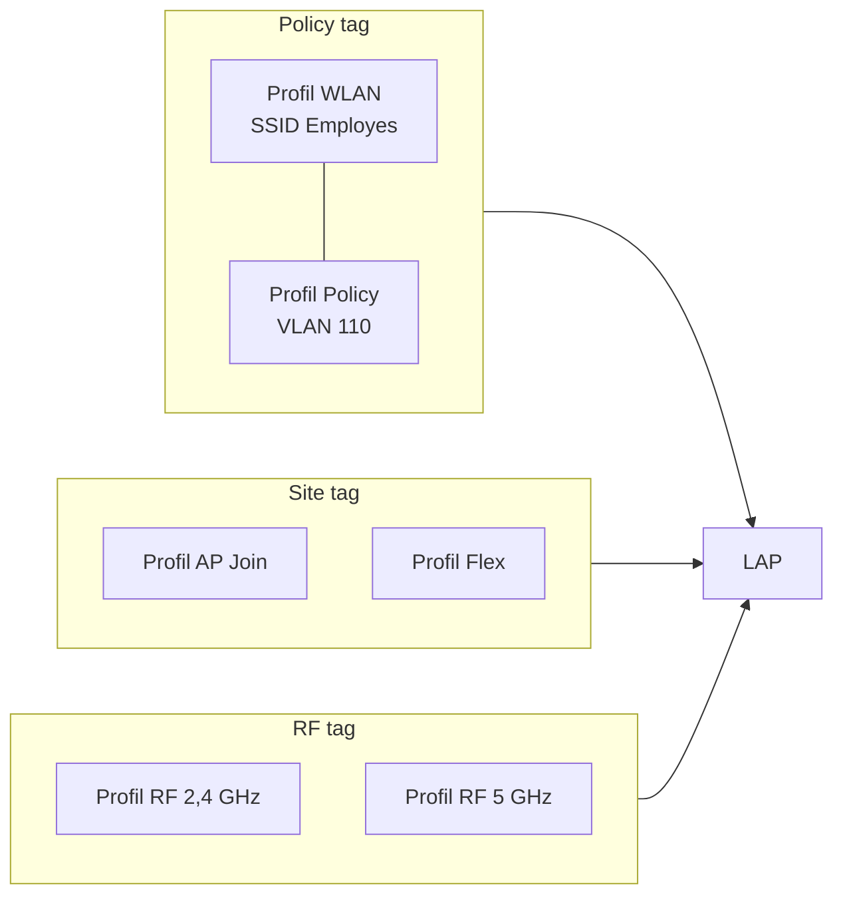

# Chapitre 1 – Le modèle de configuration : profils et tags

**Objectif :** comprendre comment un WLC 9800 organise sa configuration, pour savoir où chercher (et où modifier) un paramètre.

## 1.1 Le problème à résoudre

Un WLC peut gérer des centaines de LAP, qui diffusent plusieurs SSID, dans des bâtiments aux besoins différents. Si on configurait chaque LAP un par un, on retomberait dans le problème du module 1 (les points d'accès autonomes).

Le 9800 résout cela avec un **modèle de configuration** en trois idées :

1. on décrit les paramètres une seule fois dans des **profils** ;
2. on regroupe des profils dans des **tags** ;
3. on **attribue** des tags aux LAP.

Un LAP reçoit donc sa configuration **par les tags qu'il porte**. Changer un profil modifie d'un seul coup tous les LAP dont les tags l'utilisent.

:::info[À retenir]
**Profil** = un ensemble de paramètres (« comment »). **Tag** = un regroupement de profils (« quoi »). **LAP** = il porte des tags. Pour modifier le comportement d'un LAP, on change les profils d'un tag, ou on lui attribue un autre tag.
:::

:::warning[Ne confondez pas « tag » et étiquette 802.1Q]
Le mot « tag » désigne ici un **regroupement de profils** sur le WLC. Ce n'est **pas** l'étiquette 802.1Q d'un VLAN, même si les deux mots sont les mêmes en anglais. Dans ce module, « tag » seul veut dire tag du WLC ; pour un VLAN, on parle d'**étiquette 802.1Q**.
:::

## 1.2 Les cinq profils

| Profil | Ce qu'il décrit | Exemples de paramètres |
|---|---|---|
| **WLAN** | Un réseau sans fil | SSID, type de sécurité (WPA2, WPA3, 802.1X), clé |
| **Policy** | Le **traitement** des clients d'un WLAN | VLAN, fonctions centrales ou locales (commutation, authentification, DHCP, association), ACL, QoS, durée de session |
| **AP Join** | Le comportement du **LAP** vis-à-vis du WLC | Paramètres CAPWAP, WLC de secours, accès SSH, NTP |
| **Flex** | Ce dont un LAP en commutation locale a besoin pour **travailler seul** | VLAN natif, liste des VLAN locaux, authentification locale |
| **RF** | La **radio** | Débits permis, plages de canaux et de puissances, RRM |

Remarquez la répartition :

- le profil **WLAN** dit *quel réseau* on diffuse ;
- le profil **Policy** dit *ce qu'on fait des clients* de ce réseau (c'est là que se décident le VLAN et les fonctions centrales ou locales) ;
- les profils **AP Join**, **Flex** et **RF** décrivent le **LAP** et sa radio.

## 1.3 Les trois tags

| Tag | Il regroupe | Rôle |
|---|---|---|
| **Policy tag** | Des paires **profil WLAN + profil Policy** | Quels SSID le LAP diffuse, et comment ils sont traités |
| **Site tag** | Un profil **AP Join** + un profil **Flex** | Les caractéristiques d'un **site** : mode du LAP, paramètres de commutation locale |
| **RF tag** | Un profil **RF 2,4 GHz** + un profil **RF 5 GHz** | La configuration radio |

C'est le **schéma maître** du module. Quand vous ne savez plus où vous êtes, revenez à lui : le LAP porte **un Policy tag, un Site tag et un RF tag**, et chaque tag pointe vers ses profils.

:::tip[Un moyen de s'en souvenir]
- **Policy tag** : « *quoi* diffuser, et que faire des clients » (les SSID).
- **Site tag** : « *où* et *comment* le LAP vit » (le site, local ou non).
- **RF tag** : « *comment* il émet » (la radio).
:::

## 1.4 Tags par défaut

Un 9800 contient des tags **par défaut** : `default-policy-tag`, `default-site-tag` et `default-rf-tag`. Un LAP qui n'a reçu aucune attribution reçoit ces tags. Ils ne peuvent être ni supprimés ni renommés.

:::warning[Piège classique]
Un LAP qui vient de se joindre porte les tags par défaut. Si votre SSID n'est associé à aucun Policy tag que le LAP porte, le SSID **n'est tout simplement pas diffusé**. Ce n'est pas une panne : le LAP n'a pas reçu l'instruction de le diffuser. Nous y reviendrons au chapitre 10.
:::

## 1.5 Comment attribue-t-on des tags à un LAP ?

| Méthode | Principe |
|---|---|
| **Statique** | On désigne le LAP par son adresse MAC et on lui attribue ses tags (une par une ou par fichier) |
| **Par filtre** | Une règle sur le **nom** du LAP (expression régulière) attribue des tags |
| **Par emplacement** | Les LAP d'un même emplacement (location) partagent des tags |

Il existe un ordre de priorité entre ces méthodes : l'attribution **statique** l'emporte sur les autres. Retenez surtout la logique : on peut gérer **un LAP à la fois** ou **des groupes** de LAP.

Dans l'interface web du WLC, tout se fait par menus :

| Quoi | Où |
|---|---|
| Créer les profils | *Configuration > Tags & Profiles* (WLANs, Policy, AP Join, Flex, RF) |
| Créer les tags | *Configuration > Tags & Profiles > Tags* (onglets Policy, Site, RF) |
| Attribuer les tags à un LAP | *Configuration > Wireless > Access Points* > le LAP > onglet Tags |

:::note[Libellés à valider]
Les noms des menus varient légèrement selon la version d'IOS XE. Ce qu'il faut retenir est la **structure** : un tag contient des profils, un LAP reçoit des tags.
:::

## 1.6 Pourquoi cette organisation : l'intérêt de chaque profil et de chaque tag

Chaque profil et chaque tag existe parce qu'il **change à un rythme différent** et pour des raisons différentes. Les séparer évite de tout dupliquer.

| Objet | Ce qui le fait changer | Ce que la séparation évite |
|---|---|---|
| **Profil WLAN** | Un nouveau SSID, une nouvelle clé | Redéfinir le SSID pour chaque endroit où on le diffuse |
| **Profil Policy** | Un VLAN différent, une règle de trafic | Recréer un SSID complet juste pour changer de VLAN |
| **Policy tag** | La liste des SSID d'un groupe de LAP | Associer les SSID LAP par LAP |
| **Profil AP Join** | Des règles d'administration des LAP (SSH, comptes) | Répéter ces règles dans chaque site |
| **Profil Flex** | Les VLAN et le VLAN natif **d'un site** | Mélanger les VLAN de sites différents |
| **Site tag** | Un nouveau site ou un LAP qui change de site | Reconfigurer les LAP un par un |
| **Profils RF et RF tag** | La puissance et les canaux d'une zone | Régler chaque radio à la main |

Le chapitre 7 montre cette logique sur trois configurations de sites.

## 1.7 Lien avec ce que vous connaissez déjà

Pensez à un **modèle de port** sur un commutateur : vous définissez une fois la configuration (VLAN, `portfast`, sécurité de port), puis vous l'appliquez à plusieurs ports. Les profils et les tags jouent ce rôle pour les LAP.

## À retenir

- Le modèle de configuration du 9800 repose sur des **profils**, regroupés en **tags**, attribués aux **LAP**.
- **Cinq profils** : WLAN, Policy, AP Join, Flex, RF. **Trois tags** : Policy, Site, RF.
- Un LAP sans attribution porte les tags **par défaut** : un SSID non associé n'est pas diffusé.
- Le **VLAN** et les fonctions centrales ou locales se décident dans le profil **Policy** ; ce dont le LAP a besoin pour commuter localement est dans le profil **Flex**.

## Vérifiez votre compréhension

**Question 1.** Quels profils contient un Site tag ? Un RF tag ?

Voir le corrigé

Un **Site tag** contient un profil **AP Join** et un profil **Flex**. Un **RF tag** contient un profil **RF 2,4 GHz** et un profil **RF 5 GHz**.

**Question 2.** Dans quel profil se décide le VLAN dans lequel les clients d'un SSID seront placés ?

Voir le corrigé

Dans le profil **Policy**. Le profil **WLAN** ne contient que le SSID et la sécurité, pas de VLAN.

**Question 3.** Un nouveau LAP vient de se joindre, mais le SSID « Employes » n'apparaît pas dans la liste des réseaux. Quelle est la première chose à vérifier ?

Voir le corrigé

Quels **tags** le LAP porte. Un LAP sans attribution porte les tags par défaut, qui ne diffusent pas votre SSID. Il faut lui attribuer un **Policy tag** qui associe le profil WLAN de ce SSID à un profil Policy.

**Question 4.** Pourquoi le mot « tag » peut-il porter à confusion dans un réseau qui utilise des VLAN ?

Voir le corrigé

Parce que l'**étiquette 802.1Q** d'un VLAN s'appelle aussi *tag* en anglais. Sur le WLC, un tag est un **regroupement de profils** : rien à voir avec un trunk.

