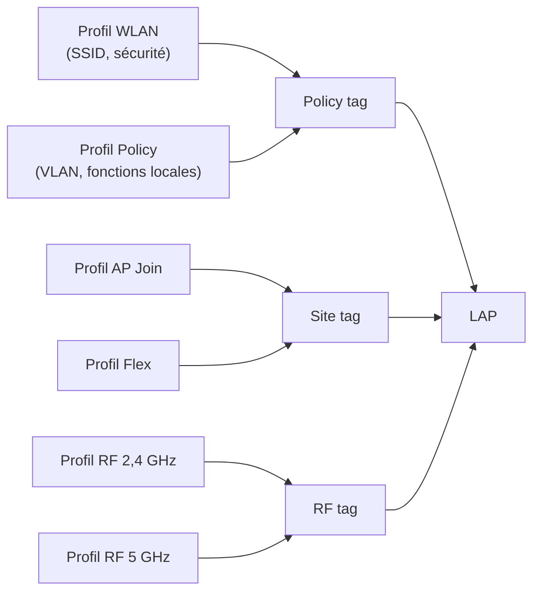

# Chapitre 11 – Guide pas à pas : une première configuration dans l'interface web

**Objectif :** savoir dans quel **ordre** créer les profils et les tags, ce que contient chaque profil, comment attribuer les tags à un LAP, et comment vérifier et sauvegarder le résultat. Ce chapitre accompagne le laboratoire de première configuration.

:::info[Une seule méthode : l'interface web]
Dans ce cours, le WLC se configure et se vérifie uniquement par son **interface web**. Les menus cités ici sont ceux d'un Catalyst 9800 ; leurs libellés peuvent varier légèrement selon la version.
:::

## 11.1 L'ordre de création

On ne peut pas mettre dans un tag un profil qui n'existe pas encore. On crée donc **d'abord les profils**, ensuite les tags qui les regroupent, et enfin on attribue les tags au LAP.

| Étape | Menu | Ce qu'on fait |
|---|---|---|
| 1 | *Configuration > Tags & Profiles > WLANs* | Créer le profil WLAN : SSID et sécurité |
| 2 | *Configuration > Tags & Profiles > Policy* | Créer le profil Policy : VLAN et fonctions locales |
| 3 | *Configuration > Tags & Profiles > Tags > Policy* | Associer le WLAN au Policy dans un Policy tag |
| 4 | *Configuration > Tags & Profiles > AP Join* et *Flex* | Créer les profils du site |
| 5 | *Configuration > Tags & Profiles > Tags > Site* | Regrouper AP Join et Flex dans un Site tag, **site local décoché** pour le mode FlexConnect |
| 6 | *Configuration > Tags & Profiles > RF* puis *Tags > RF* | Créer les profils RF (2,4 et 5 GHz) et le RF tag |
| 7 | *Configuration > Wireless > Access Points* | Attribuer les trois tags au LAP |

:::tip[Les profils par défaut]
Chaque type de profil et chaque tag existe en version par défaut (*default-policy-profile*, *default-site-tag*, etc.). Ils ne peuvent être **ni supprimés ni renommés**. On crée les siens à côté, plutôt que de modifier ceux-là.
:::

## 11.2 Ce que contient chaque profil

| Profil | Ce qu'on y règle (exemples) | Valeur par défaut à connaître |
|---|---|---|
| **WLAN** | Nom, état, SSID, diffusion du SSID, sécurité de couche 2 et de couche 3, serveurs AAA, nombre maximal de clients, blocage entre clients | Le SSID est un nom : un même profil peut servir à plusieurs tags |
| **Policy** | VLAN des clients, délai d'inactivité, qualité de service, ACL, et les quatre fonctions centrales ou locales | Commutation **centrale**, VLAN de **gestion** (à changer : nous utilisons la commutation locale) |
| **AP Join** | État des LED, minuteries CAPWAP, WLC primaire et secondaire, accès SSH ou Telnet, compte d'administration du LAP, journalisation | Les valeurs par défaut conviennent pour un laboratoire |
| **Flex** | **VLAN natif**, liste des **VLAN** locaux, authentification locale, ACL, proxy HTTP, mise en cache ARP | Aucun VLAN déclaré |
| **RF** | Débits permis, plages de canaux, puissance minimale et maximale, largeur de canal, nombre maximal de clients, équilibrage de charge | Un profil par bande |

:::note[Où est le choix central ou local ?]
Le profil Policy dit **ce que le client demande** (le WLC ou le LAP commute-t-il ses trames ?). Mais c'est le **Site tag** qui décide si le LAP est en **mode local** ou **FlexConnect**. Si le site est local, le LAP ignore la commutation locale du profil Policy (chapitre 4).
:::

## 11.3 Les profils RF : puissance et canaux

Un profil RF règle les **radios** d'une bande. Il fait partie de la fonction **RRM** (*Radio Resource Management*), qui permet au WLC d'ajuster les radios de plusieurs LAP selon l'environnement.

| Fonction | Rôle | Réglage dans le profil |
|---|---|---|
| **TPC** (*Transmit Power Control*) | Ajuste la **puissance** d'émission de chaque LAP | Puissances minimale et maximale |
| **DCA** (*Dynamic Channel Assignment*) | Choisit le **canal** de chaque LAP | Liste des canaux permis, largeur de canal |

Deux idées à retenir :

- **En 2,4 GHz**, seuls les canaux **1, 6 et 11** ne se chevauchent pas. Les LAP voisins doivent donc se partager trois canaux, et la **puissance** devient le principal moyen de limiter l'interférence.
- **En 5 GHz**, les canaux sont plus nombreux et sans chevauchement : on peut utiliser des canaux plus **larges** (40 ou 80 MHz) pour plus de débit.

Dans une salle de laboratoire où plusieurs LAP voisins émettent en même temps, on réduit la puissance maximale (par exemple à -10 dBm) pour que chaque réseau ne couvre que sa propre zone.

## 11.4 Les profils AP Join et Flex pour un laboratoire

| Réglage | Valeur de laboratoire | Pourquoi |
|---|---|---|
| Accès SSH | Activé, Telnet désactivé | SSH chiffre la session |
| Compte du LAP | Un utilisateur et un secret | Permet d'administrer le LAP |
| Détection d'AP intrus (*Rogue Detection*) | Désactivée | Les LAP des autres étudiants seraient signalés comme intrus |
| VLAN natif du profil Flex | Le même que celui du port du LAP | Voir la question 3 |

:::warning[Le VLAN natif]
Le VLAN natif du profil Flex doit être **identique** au VLAN natif du port du commutateur d'accès où le LAP est branché. Sur un port d'accès, c'est le VLAN d'accès.
:::

## 11.5 Attribuer les tags au LAP

Il y a trois façons de donner des tags à un LAP, que l'on gère dans *Configuration > Tags & Profiles > Tags*, onglet **AP** :

| Méthode | Principe | Quand l'utiliser |
|---|---|---|
| **Statique** | Par l'adresse MAC du LAP, avec importation possible d'un fichier CSV | Peu de LAP, ou cas particuliers |
| **Filtre** | Par une règle sur le **nom** du LAP | Nommage régulier (par exemple AP-CAMPUS-xx) |
| **Emplacement** | Par le champ **Location** du LAP | Beaucoup de LAP répartis par site |

Il existe un ordre de priorité entre ces méthodes : la méthode **statique** l'emporte.

On peut aussi attribuer les tags directement dans la page du LAP (*Configuration > Wireless > Access Points*). Dans ce cas, la case **Write Tag Config to AP** décide **où** les tags sont mémorisés :

:::warning[Write Tag Config to AP]
Cochée, elle écrit les tags **dans le LAP lui-même**. Si le LAP est ensuite déplacé vers un autre WLC (un LAP de laboratoire partagé, par exemple), il apporte avec lui ces tags. Décochée, les tags ne sont connus que du WLC. Dans un laboratoire où les LAP circulent d'un étudiant à l'autre, **on ne la coche pas**.
:::

Après l'attribution, le LAP se **déconnecte puis se rejoint** pour recevoir sa configuration. Le passage de local à FlexConnect peut demander un **redémarrage**.

## 11.6 Vérifier et sauvegarder

1. *Configuration > Wireless > Access Points*, détail du LAP : les trois tags et le **mode** (FlexConnect ou local).
2. *Monitoring > Wireless > Clients*, détail d'un client : SSID, profil Policy, VLAN, adresse IP, mode de commutation.
3. **Sauvegardez** : bouton *Save Configuration* de la barre supérieure, puis exportez une copie sur votre ordinateur (menu *Administration*, section sauvegarde et restauration).

:::danger[Une machine virtuelle qui s'arrête]
Si le WLC virtuel s'arrête avant la sauvegarde, la configuration est perdue. Sauvegardez après chaque grande étape.
:::

## À retenir

- On crée les **profils d'abord**, les **tags ensuite**, et on attribue les tags au LAP **en dernier**.
- Le **Site tag non local** met le LAP en **FlexConnect**; le profil Policy seul ne suffit pas.
- Les profils **RF** règlent la puissance (TPC) et les canaux (DCA) : la puissance limite l'interférence en 2,4 GHz.
- Le **VLAN natif** du profil Flex doit correspondre à celui du port du LAP.
- **Write Tag Config to AP** : décochée dans un laboratoire de LAP partagés.
- Les tags s'attribuent de façon **statique**, par **filtre** ou par **emplacement**.

## Vérifiez votre compréhension

**Question 1.** Pourquoi crée-t-on les profils avant les tags ?

Voir le corrigé

Parce qu'un tag est un **regroupement de profils** : il ne peut contenir que des profils qui existent déjà.

**Question 2.** Un étudiant a créé son Policy tag et son Policy profile en commutation locale, mais son LAP est en mode local. Quel tag a-t-il oublié de régler, et comment ?

Voir le corrigé

Le **Site tag** : il faut lui attribuer un tag dont *Enable Local Site* est **décoché** et qui contient un profil Flex. Sans cela, le profil Policy local est ignoré.

**Question 3.** Le profil Flex a un VLAN natif 1 et le port du LAP est un port d'accès dans le VLAN 50. Qu'attendez-vous ?

Voir le corrigé

Le LAP et le commutateur ne s'entendent pas sur le VLAN non étiqueté : le LAP risque de perdre son accès au réseau ou de placer ses VLAN au mauvais endroit. Le profil Flex doit avoir le VLAN natif **50**.

**Question 4.** Pourquoi réduit-on la puissance maximale des LAP dans une salle de laboratoire en 2,4 GHz ?

Voir le corrigé

Parce qu'il n'y a que **trois canaux** sans chevauchement en 2,4 GHz : les LAP voisins sont forcément sur les mêmes canaux. Réduire la puissance limite la zone couverte par chaque LAP, donc l'interférence entre réseaux voisins.

**Question 5.** Pourquoi ne coche-t-on pas *Write Tag Config to AP* dans un laboratoire où les LAP sont partagés ?

Voir le corrigé

Les tags seraient mémorisés **dans le LAP** et le suivraient chez l'étudiant suivant, avec la configuration d'un autre WLC.

