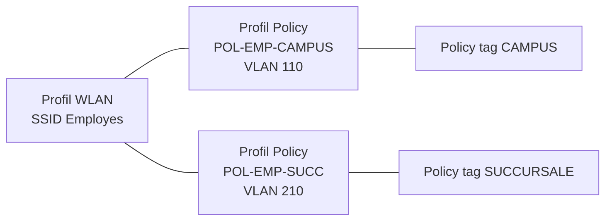

# Chapitre 2 – Le profil Policy : une commutation locale et trois fonctions à choisir

**Objectif :** comprendre ce que décide le profil Policy, pourquoi on sépare le profil WLAN du profil Policy, et quelles fonctions se choisissent *au WLC* ou *au LAP*.

:::info[Portée de ce cours]
Dans ce cours, la **commutation est toujours locale** : le LAP dépose lui-même les trames des clients sur le réseau filaire (mode FlexConnect). La commutation **centrale**, où les données des clients passent par le WLC, est étudiée dans un cours ultérieur. Les trois autres fonctions du profil Policy (**DHCP**, **association** et **authentification**) restent à choisir, et elles sont l'objet des chapitres 4 à 6.
:::

## 2.1 Un SSID, deux objets

Un réseau sans fil est décrit par **deux profils** reliés dans un Policy tag :

- le **profil WLAN** : le SSID et la sécurité ;
- le **profil Policy** : ce qu'on fait des clients de ce SSID.

Pourquoi deux ? Parce qu'un même SSID peut être **traité différemment selon l'endroit**. Exemple :

Au **campus**, le SSID « Employes » place les clients dans le VLAN 110. À la **succursale**, le **même** SSID les place dans le VLAN 210. Le profil WLAN est réutilisé ; seul le profil Policy change, et on a deux Policy tags.

:::info[À retenir]
Le profil **WLAN** dit *ce qu'on diffuse*. Le profil **Policy** dit *ce qu'on fait des clients*. C'est le **Policy tag** qui relie les deux, et c'est le Policy tag qu'un LAP porte.
:::

## 2.2 Ce que contient un profil Policy

| Paramètre | Rôle |
|---|---|
| **VLAN** (nom ou numéro) | Le VLAN dans lequel les clients sont placés |
| **Commutation** | Par où passent les données des clients : **locale** dans ce cours |
| **Association** | Où l'association du client est gérée (chapitre 5) |
| **Authentification** | Qui réalise l'authentification du client (chapitre 6) |
| **DHCP** | Où le DHCP est traité (chapitre 4) |
| ACL, QoS, durée de session, etc. | Contrôles de trafic et de session |

## 2.3 Les quatre fonctions « MAC » : central ou local

Rappelez-vous le module 1 : dans l'architecture **split-MAC**, le travail d'un point d'accès est réparti entre le LAP et le WLC. Le profil Policy permet de choisir, **pour chaque réseau sans fil**, où quatre fonctions sont exécutées :

| Fonction | Si elle est **centrale** (au WLC) | Si elle est **locale** (au LAP) |
|---|---|---|
| **Commutation** | Les données des clients passent par le WLC dans le tunnel CAPWAP | Le LAP dépose directement les trames sur le réseau filaire |
| **DHCP** | Les requêtes DHCP des clients sont traitées par le WLC | Les requêtes DHCP sortent sur le réseau filaire, dans le VLAN du client |
| **Association** | Le WLC gère l'association du client | Le LAP gère l'association du client |
| **Authentification** | Le WLC dialogue avec le serveur d'authentification | Le LAP dialogue lui-même avec le serveur ou avec sa base locale |

:::note[À propos des libellés]
Dans l'interface du 9800, ces choix s'appellent en anglais *Central Switching*, *Central DHCP*, *Central Association* et *Central Authentication*. Les libellés et les règles de compatibilité varient selon la version : vérifiez-les dans votre WLC.
:::

Dans ce cours, la commutation est **locale**. Pour les trois autres fonctions, nous étudions chaque cas :

| Fonction | Théorie | Expérimentation |
|---|---|---|
| DHCP | Local et central | **Local** |
| Association | Local et central | Aucune |
| Authentification | Local et central | Réseau ouvert, centrale, locale |

## 2.4 Pourquoi autant de choix ? Le mode connecté et le mode autonome

Un LAP en commutation locale est un LAP FlexConnect : il **continue de travailler** même si le WLC devient inaccessible. Ce qu'il peut faire seul dépend des fonctions qu'on lui a confiées :

| Fonction | Effet si le WLC est perdu |
|---|---|
| Commutation locale | Les clients déjà connectés conservent leur accès |
| Association locale | De **nouveaux** clients peuvent encore s'associer |
| DHCP local | Les clients obtiennent encore une adresse |
| Authentification locale | De nouveaux clients peuvent encore être authentifiés |

Chaque fonction laissée **au WLC** devient une fonction que le LAP ne peut **plus** assurer sans lui. C'est ce qui motive le choix.

## 2.5 Les combinaisons typiques

Avec la commutation locale, voici les deux combinaisons qu'on rencontre le plus :

| Combinaison | Commutation | Association | DHCP | Authentification | Quand |
|---|---|---|---|---|---|
| **Locale, avec authentification centrale** | Locale | Locale | Local | **Centrale** | Le WLC garde le contrôle des utilisateurs (serveur RADIUS joint par le WLC) |
| **Tout local** | Locale | Locale | Local | **Locale** | Site qui doit rester autonome si le WLC est perdu |

:::warning[Un choix n'est pas toujours libre]
Plusieurs combinaisons sont **interdites** par le WLC : par exemple, l'authentification locale suppose la commutation locale. Quand un choix semble impossible, ce n'est pas un bogue : consultez la documentation de la version.
:::

## 2.6 Comment les clients trouvent leur VLAN

Le **VLAN** des clients est désigné dans le profil Policy. Avec la commutation locale, ce VLAN doit exister :

- sur le **LAP** (déclaré dans le profil Flex) ;
- sur le **commutateur d'accès** (autorisé sur le trunk du port du LAP) et sur le **lien montant** ;
- sur la **distribution** (SVI, HSRP, DHCP).

Le WLC n'a pas besoin de ce VLAN pour le trafic des clients. Le chapitre 3 détaille cette chaîne.

Dans l'interface web (*Configuration > Tags & Profiles > Policy*), un profil Policy « tout local » se reconnaît à ses cases :

| Réglage | Valeur |
|---|---|
| Onglet General : Central Switching | **Décoché** |
| Onglet General : Central Authentication | **Décoché** (ou coché, avec authentification centrale) |
| Onglet General : Central DHCP | **Décoché** |
| Onglet General : Central Association | **Décoché** |
| Onglet Access Policies : VLAN | Le VLAN du SSID (par exemple 110) |

## 2.7 Un Policy tag peut contenir plusieurs SSID

Un Policy tag associe **une ou plusieurs paires** profil WLAN → profil Policy. Un LAP qui porte ce tag diffuse donc tous les SSID de la liste, chacun avec son propre profil Policy et donc **son propre VLAN**. On peut ainsi avoir, sur **un même LAP**, un SSID « Employes » dans le VLAN 110 et un SSID « Invites » dans le VLAN 120 (chapitre 3).

## À retenir

- Le profil **WLAN** décrit le SSID ; le profil **Policy** décrit le traitement des clients ; le **Policy tag** les relie.
- Le profil Policy règle quatre fonctions, **centrales** (WLC) ou **locales** (LAP) : **commutation, DHCP, association, authentification**.
- Dans ce cours, la **commutation est locale** ; la commutation centrale est étudiée plus tard.
- Plus on confie de fonctions au **LAP**, plus il reste utile si le WLC est perdu.
- Le **VLAN des clients** est désigné dans le profil Policy.

## Vérifiez votre compréhension

**Question 1.** Pourquoi sépare-t-on le profil WLAN du profil Policy ?

Voir le corrigé

Pour pouvoir **réutiliser un même SSID** avec des traitements différents selon l'endroit : deux Policy tags peuvent associer le même profil WLAN à deux profils Policy différents (par exemple le VLAN 110 au campus et le VLAN 210 à la succursale).

**Question 2.** Citez les quatre fonctions MAC qu'un profil Policy permet de choisir entre le WLC et le LAP.

Voir le corrigé

La **commutation**, le **DHCP**, l'**association** et l'**authentification**.

**Question 3.** Un SSID est configuré en commutation locale. Sur quels équipements le VLAN des clients doit-il être déclaré ?

Voir le corrigé

Sur le **LAP** (profil Flex), sur le **commutateur d'accès** (trunk du port du LAP et lien montant), et sur la **distribution** (SVI, HSRP, DHCP). Le WLC n'a pas besoin de ce VLAN pour le trafic des clients.

**Question 4.** Un seul LAP peut-il diffuser deux SSID dans deux VLAN différents ?

Voir le corrigé

Oui : son Policy tag associe chaque SSID à un profil Policy dont le VLAN est différent. Le profil Flex du site doit alors déclarer **les deux VLAN**, et le trunk du LAP doit les autoriser.

