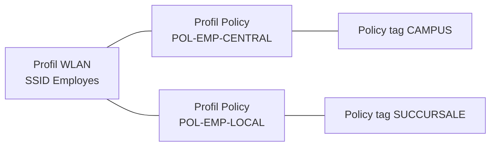

# Chapitre 2 – Le profil Policy et ses quatre fonctions

**Objectif :** comprendre ce que décide le profil Policy, et pourquoi on sépare le profil WLAN du profil Policy.

## 2.1 Un SSID, deux objets

Un réseau sans fil est décrit par **deux profils** reliés dans un Policy tag :

- le **profil WLAN** : le SSID et la sécurité ;
- le **profil Policy** : ce qu'on fait des clients de ce SSID.

Pourquoi deux ? Parce qu'un même SSID peut être **traité différemment selon l'endroit**. Exemple :



Au **campus**, le SSID « Employes » est traité en commutation **centrale** ; à la **succursale**, le **même** SSID est traité en commutation **locale**. Le profil WLAN est réutilisé, seul le profil Policy change : on a deux Policy tags.

:::info[À retenir]
Le profil **WLAN** dit *ce qu'on diffuse*. Le profil **Policy** dit *ce qu'on fait des clients*. C'est le **Policy tag** qui relie les deux, et c'est le Policy tag qu'un LAP porte.
:::

## 2.2 Ce que contient un profil Policy

| Paramètre | Rôle |
|---|---|
| **VLAN** (nom ou numéro) | Le VLAN dans lequel les clients sont placés |
| Commutation centrale ou locale | Par où passent les données des clients |
| Authentification centrale ou locale | Qui parle au serveur d'authentification |
| DHCP central ou local | Où le DHCP est traité |
| Association centrale ou locale | Où l'association du client est gérée |
| ACL, QoS, durée de session, etc. | Contrôles de trafic et de session |

Les **quatre fonctions** centralisables (commutation, authentification, DHCP, association) sont le cœur de ce chapitre.

## 2.3 Les quatre fonctions « MAC » : central ou local

Rappelez-vous le module 1 : dans l'architecture **split-MAC**, le travail d'un point d'accès est réparti entre le LAP et le WLC. Le profil Policy permet de choisir, **pour chaque réseau sans fil**, où quatre fonctions sont exécutées :

| Fonction | Si elle est **centrale** (au WLC) | Si elle est **locale** (au LAP) |
|---|---|---|
| **Commutation** | Les données des clients passent par le WLC dans le tunnel CAPWAP | Le LAP dépose directement les trames sur le réseau filaire |
| **Authentification** | Le WLC dialogue avec le serveur d'authentification | Le LAP dialogue lui-même avec le serveur (voir le module 3) |
| **DHCP** | Les requêtes DHCP des clients sont traitées au niveau du WLC | Les requêtes DHCP sortent sur le réseau local du LAP |
| **Association** | Le WLC gère l'association des clients | Le LAP gère l'association des clients |

:::note[À propos des libellés]
Dans l'interface du 9800, ces choix s'appellent en anglais *Central Switching*, *Central Authentication*, *Central DHCP* et *Central Association*. Les libellés et les règles de compatibilité peuvent varier selon la version : vérifiez-les dans votre WLC.
:::

Dans ce module, nous nous concentrons sur la **commutation** (les chapitres 3 à 6). L'**authentification** est étudiée au module suivant (802.1X et RADIUS). Le **DHCP** et l'**association** sont des réglages d'appoint dont nous expliquons l'effet ci-dessous.

## 2.4 Les combinaisons

Les quatre fonctions ne sont pas indépendantes : certaines combinaisons n'ont pas de sens ou ne sont pas permises. Voici les trois situations typiques.

| Scénario | Commutation | Authentification | DHCP | Association | Cas d'usage |
|---|---|---|---|---|---|
| **Tout central** | Centrale | Centrale | Central | Centrale | Campus : le WLC contrôle tout |
| **Commutation locale, reste central** | Locale | Centrale | Local | Centrale | Succursale : les données restent locales, le WLC gère l'authentification |
| **Tout local** | Locale | Locale | Local | Locale | Succursale autonome : peut continuer si le WLC est inaccessible |

:::warning[Un choix n'est pas toujours libre]
Plusieurs combinaisons sont **interdites** par le WLC : par exemple, l'authentification locale suppose la commutation locale. Le WLC refuse la combinaison ou la signale. Quand un choix semble impossible, ce n'est pas un bug : consultez la documentation de la version.
:::

## 2.5 Comment les trames d'un client trouvent leur VLAN

Dans le profil Policy, on désigne le **VLAN** des clients :

- en **commutation centrale**, ce VLAN doit exister sur le **WLC** (c'est le WLC qui dépose la trame sur ce VLAN) ;
- en **commutation locale**, ce VLAN doit exister sur le **LAP** (déclaré dans le profil Flex) et sur le **commutateur d'accès** (autorisé sur le trunk du LAP).

Nous détaillons chaque cas aux chapitres 3 et 4.

Exemple indicatif de profil Policy en commutation centrale :

```text
wireless profile policy POL-EMPLOYES-CENTRAL
 vlan VLAN110
 central switching
 central dhcp
 no shutdown
```

Exemple indicatif en commutation locale :

```text
wireless profile policy POL-EMPLOYES-LOCAL
 vlan VLAN110
 no central switching
 no central dhcp
 no shutdown
```

:::note[Syntaxe à valider]
Certaines options (par exemple l'association centrale) ont leur propre ligne selon la version. Ce qui importe : **`central switching`** est le réglage qui fait la différence entre les deux modes.
:::

## 2.6 Un Policy tag peut contenir plusieurs SSID

Un Policy tag associe **une ou plusieurs paires** profil WLAN → profil Policy. Un LAP qui porte ce tag diffusera donc tous les SSID de la liste, chacun avec son propre profil Policy. On peut ainsi avoir, sur **un même LAP**, un SSID « Employes » en commutation centrale et un SSID « Invites » en commutation locale (nous y reviendrons au chapitre 5).

## À retenir

- Le profil **WLAN** décrit le SSID ; le profil **Policy** décrit le traitement des clients ; le **Policy tag** les relie.
- Le profil Policy règle quatre fonctions, **centrales** (WLC) ou **locales** (LAP) : **commutation, authentification, DHCP, association**.
- Les trois configurations typiques : **tout central**, **commutation locale avec reste central**, **tout local**.
- Le **VLAN des clients** est désigné dans le profil Policy ; **où ce VLAN doit exister** dépend du mode de commutation.

## Vérifiez votre compréhension

**Question 1.** Pourquoi sépare-t-on le profil WLAN du profil Policy ?

<details>
<summary>Voir le corrigé</summary>

Pour pouvoir **réutiliser un même SSID** avec des traitements différents selon l'endroit : deux Policy tags peuvent associer le même profil WLAN à deux profils Policy différents (par exemple commutation centrale au campus, locale à la succursale).

</details>

**Question 2.** Citez les quatre fonctions MAC qu'un profil Policy permet de centraliser.

<details>
<summary>Voir le corrigé</summary>

La **commutation**, l'**authentification**, le **DHCP** et l'**association**.

</details>

**Question 3.** Un SSID est configuré en commutation **locale**. Sur quels équipements le VLAN des clients doit-il être déclaré ?

<details>
<summary>Voir le corrigé</summary>

Sur le **LAP** (profil Flex), sur le **commutateur d'accès** (autorisé sur le trunk du port du LAP et sur le lien montant), et sur la **distribution** (SVI et HSRP pour la passerelle). Le WLC n'a pas besoin de ce VLAN pour le trafic des clients.

</details>

**Question 4.** Un seul LAP peut-il diffuser un SSID en commutation centrale et un autre en commutation locale ?

<details>
<summary>Voir le corrigé</summary>

Oui, si son Policy tag associe chaque SSID à un profil Policy différent, et si le LAP fonctionne en **mode FlexConnect** (chapitre 4). Chaque SSID est alors traité selon son propre profil Policy.

</details>
