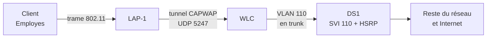

# Chapitre 3 – La commutation centrale

**Objectif :** suivre le chemin d'une trame de client en commutation centrale, et savoir quoi configurer sur chaque équipement.

## 3.1 Le principe

En commutation **centrale**, le LAP ne dépose **aucune** trame de client sur le réseau filaire. Il l'**encapsule** dans un tunnel CAPWAP (canal de **données**, UDP 5247) et l'envoie au **WLC**. C'est le WLC qui la décapsule et la place sur le bon **VLAN** de son côté filaire.

Tout le trafic des clients **passe donc par le WLC**, même quand deux clients du même LAP veulent se parler.



:::info[À retenir]
Commutation centrale : le client est **terminé au WLC**. Le VLAN du client **n'existe pas sur le réseau d'accès** : il n'apparaît qu'entre le WLC et la distribution.
:::

## 3.2 Le trajet, étape par étape

Suivons une requête du client « Employes » (VLAN 110) vers Internet.

| Étape | Où | Ce qui se passe |
|---|---|---|
| 1 | Client → LAP-1 | Trame 802.11 |
| 2 | LAP-1 | Encapsulation dans CAPWAP. Paquet IP **LAP → WLC** (10.0.50.x → 10.0.99.10), UDP 5247 |
| 3 | LAP-1 → AS1 | Paquet envoyé dans le **VLAN 50**, port d'accès, **sans étiquette** |
| 4 | AS1 → DS1 | Trunk, VLAN 50 |
| 5 | DS1 | Routage : VLAN 50 → VLAN 99 (SVI) |
| 6 | DS1 → WLC | Paquet CAPWAP arrive au WLC dans le **VLAN 99** |
| 7 | WLC | Décapsulation. La trame du client est **placée sur le VLAN 110** et envoyée vers DS1 |
| 8 | WLC → DS1 | **Trunk** portant le VLAN 110 |
| 9 | DS1 | Le client a pour passerelle 10.0.110.1 : la SVI 110 de DS1 (HSRP) route vers Internet |

Remarquez qu'il y a **deux trajets distincts** à ne pas confondre :

- le **tunnel** LAP ↔ WLC (VLAN 50 puis 99) : c'est du CAPWAP, il suit la topologie du module 1 ;
- le **trafic du client** sorti du WLC (VLAN 110) : c'est le trafic « réel » du client.

## 3.3 Ce qu'il faut configurer

### Sur le profil Policy

Dans *Configuration > Tags & Profiles > Policy*, profil **POL-EMPLOYES-CENTRAL** : **Central Switching** coché, VLAN **110** (onglet Access Policies), profil activé.

### Sur le WLC

Le VLAN 110 doit **exister** sur le WLC, et le lien du WLC vers la distribution doit le **transporter**.

Dans l'interface web : *Configuration > Layer2 > VLAN*, créez le VLAN 110 avec le nom VLAN110.

Le lien physique du WLC vers la distribution est un **trunk** (souvent un port-channel, voir le chapitre 3 du module 1) qui **autorise** les VLAN de gestion et des clients :

```text
! Sur DS1 - lien vers le WLC
interface Port-channel10
 description Vers WLC
 switchport mode trunk
 switchport trunk allowed vlan 99,110,120
```

:::tip[Le WLC n'a généralement pas besoin d'adresse IP dans le VLAN du client]
Sur le WLC, le VLAN du client est un VLAN de **couche 2** : le WLC ne route pas le trafic des clients. La **passerelle** reste la SVI de la distribution. Seule l'interface de gestion (la WMI, VLAN 99) a une adresse IP.
:::

### Sur le commutateur d'accès (port du LAP)

Un **port d'accès**, dans le VLAN des LAP. Aucun VLAN de client n'est nécessaire sur l'accès.

```text
interface GigabitEthernet1/0/10
 description LAP-1 (commutation centrale)
 switchport mode access
 switchport access vlan 50
 spanning-tree portfast
```

### Sur la distribution

- la **SVI** et le **HSRP** du VLAN 110 (la passerelle des clients) ;
- le trunk vers le WLC doit **autoriser** le VLAN 110 ;
- le DHCP du VLAN 110 (pool local sur la distribution, ou `ip helper-address` vers un serveur).

```text
interface Vlan110
 description Clients Employes
 ip address 10.0.110.2 255.255.255.0
 ip helper-address 10.0.99.5
 standby version 2
 standby 110 ip 10.0.110.1
 standby 110 priority 110
 standby 110 preempt
```

## 3.4 Ce que la commutation centrale apporte

- **Un VLAN de client n'a pas besoin d'exister sur les commutateurs d'accès.** Vous configurez les VLAN 110 et 120 à **un seul endroit** (WLC et distribution), même avec des dizaines de commutateurs d'accès.
- **Itinérance simple** : un client qui passe d'un LAP à l'autre reste dans le **même VLAN, terminé au même WLC**, quel que soit le commutateur d'accès où le LAP est branché.
- **Politique centralisée** : les ACL et le contrôle de trafic s'appliquent au WLC, à un seul endroit.
- **Ports d'accès simples** : le LAP se branche sur un port d'accès ordinaire.

## 3.5 Ce que la commutation centrale coûte

- **Tout le trafic des clients passe par le WLC**, qui devient un point de passage et un goulot d'étranglement possible. La capacité du WLC (et de son lien) doit suivre.
- **Détour** : deux clients du même LAP qui se parlent voient leurs trames faire l'aller-retour au WLC.
- **Dépendance** : si le LAP **perd** le WLC, il ne peut plus transmettre les données des clients : le service est interrompu (voir le module 1, résilience).
- **Dépendance au trunk du WLC** : le WLC doit être raccordé à tous les VLAN de clients. C'est ce qu'un **WLC en machine virtuelle sans trunk** ne permet pas (voir le chapitre 9).

:::warning[Piège : le VLAN du client sur le trunk du WLC]
Un trunk qui n'autorise pas le VLAN 110 produit un symptôme très typique : le client **s'associe** au SSID (tout semble bien), mais n'obtient **aucune adresse IP**. Le chapitre 8 en fait un scénario.
:::

## À retenir

- En commutation centrale, la trame du client est **encapsulée** (CAPWAP, UDP 5247) et envoyée au **WLC**, qui la dépose sur le **VLAN** du profil Policy.
- Le port du LAP est un **port d'accès** dans le **VLAN des LAP** ; le VLAN du client n'existe pas sur l'accès.
- Le **VLAN du client** doit exister sur le **WLC** et être **autorisé sur le trunk** WLC ↔ distribution ; la passerelle est la **SVI** de la distribution.
- Avantage : simplicité et politique centralisée. Coût : tout le trafic passe par le **WLC**.

## Vérifiez votre compréhension

**Question 1.** En commutation centrale, dans quel VLAN circule le paquet CAPWAP entre le LAP et AS1 ? Dans quel VLAN circule le trafic du client entre le WLC et DS1 ?

<details>
<summary>Voir le corrigé</summary>

Entre le LAP et AS1 : le **VLAN 50** (celui des LAP), sans étiquette. Entre le WLC et DS1 : le **VLAN 110** (celui du client), en trunk avec étiquette 802.1Q. Ce sont deux trajets distincts.

</details>

**Question 2.** Faut-il créer le VLAN 110 sur le commutateur d'accès AS1 ? Pourquoi ?

<details>
<summary>Voir le corrigé</summary>

**Non.** En commutation centrale, le client est terminé au WLC : le VLAN 110 ne passe jamais par AS1. AS1 ne voit que le VLAN 50 (celui du LAP).

</details>

**Question 3.** Un client s'associe au SSID mais n'obtient pas d'adresse IP. Le SSID est en commutation centrale. Quelle première vérification faites-vous ?

<details>
<summary>Voir le corrigé</summary>

Que le **VLAN du client (110)** est bien **autorisé sur le trunk** entre le WLC et la distribution, qu'il **existe** sur le WLC, et que la SVI/HSRP et le DHCP existent sur la distribution.

</details>

**Question 4.** Citez un avantage et un inconvénient de la commutation centrale.

<details>
<summary>Voir le corrigé</summary>

Avantage (au choix) : VLAN des clients configurés à un seul endroit, itinérance simple, politique centralisée. Inconvénient (au choix) : tout le trafic passe par le WLC (goulot d'étranglement), service interrompu si le WLC est perdu.

</details>
