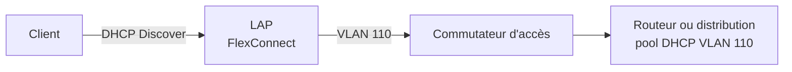

# Chapitre 4 – Le DHCP : local et central

**Objectif :** comprendre où les requêtes DHCP des clients sont traitées, et pourquoi nous expérimentons le DHCP **local**.

## 4.1 Le problème

Un client Wi-Fi qui s'associe envoie une requête DHCP *Discover* pour obtenir une adresse. La question est : **par où cette requête sort-elle du réseau sans fil ?** Le profil Policy choisit.

## 4.2 DHCP local

Avec la commutation locale, la requête DHCP du client sort **du LAP, dans le VLAN du client**, étiquetée 802.1Q sur le trunk. Elle atteint le serveur DHCP ou le relais de ce VLAN, comme pour n'importe quel poste filaire.

Dans nos laboratoires : le pool DHCP du VLAN du client est sur le routeur ou la distribution (cases **Central DHCP décochée**). Le WLC n'intervient pas.

## 4.3 DHCP central

Avec le DHCP **central**, la requête du client est **prise en charge par le WLC** (qui peut la relayer vers un serveur DHCP ou y répondre lui-même), puis la réponse revient au client par le LAP. Le DHCP central sert surtout quand le WLC doit **contrôler ou enregistrer** l'attribution des adresses (par exemple pour savoir quelle adresse a quel client).

| | DHCP local | DHCP central |
|---|---|---|
| Où la requête sort | Du **LAP**, dans le VLAN du client | Elle passe par le **WLC** |
| Le WLC voit-il l'adresse du client ? | Pas par ce chemin | Oui |
| Si le WLC est perdu | Les clients obtiennent encore une adresse | Plus d'adresse pour les nouveaux clients |
| Dans ce cours | **Expérimenté** | Théorie seulement |

:::note[À valider]
La combinaison commutation locale + DHCP central dépend de la version et du nombre d'interfaces du WLC. Elle n'est pas expérimentée ici : c'est de la théorie.
:::

## 4.4 Ce qu'il faut pour que le DHCP local fonctionne

1. Le VLAN du client est **déclaré** dans le profil Policy et le profil Flex.
2. Le VLAN est **autorisé** sur le trunk du LAP et sur les liens montants.
3. Un **pool DHCP** existe pour le VLAN, sur un routeur ou la distribution (adresse de passerelle, plage, exclusions).

Si l'un de ces maillons manque, le client s'associe mais reste sans adresse (169.254...).

## À retenir

- **DHCP local** : la requête sort du LAP dans le VLAN du client ; **DHCP central** : elle passe par le WLC.
- Dans ce cours, le DHCP est **local** : le pool est sur le routeur ou la distribution.
- Un client associé sans adresse IP : suspectez un **maillon de VLAN**, puis le **pool DHCP**.

## Vérifiez votre compréhension

**Question 1.** En DHCP local, par où sort la requête d'un client ?

Voir le corrigé

Par le **LAP**, dans le **VLAN du client**, étiquetée sur le trunk du port du LAP.

**Question 2.** Quel avantage le DHCP local offre-t-il si le WLC est perdu ?

Voir le corrigé

Les nouveaux clients peuvent encore obtenir une adresse, puisque la requête n'a pas besoin du WLC.

**Question 3.** Un client s'associe mais a l'adresse 169.254.x.x. Citez deux causes possibles.

Voir le corrigé

VLAN absent du **trunk** (LAP ou lien montant) ou du **profil Flex** ; **pool DHCP** absent ou erroné pour ce VLAN.

