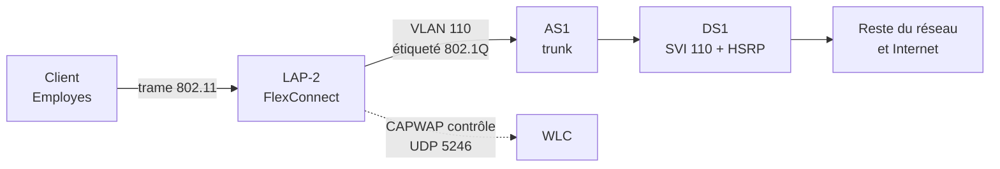

# Chapitre 4 – La commutation locale (FlexConnect)

**Objectif :** suivre le chemin d'une trame de client en commutation locale, et savoir quoi configurer sur chaque équipement.

## 4.1 Le principe

En commutation **locale**, le LAP **dépose directement** la trame du client sur le réseau filaire, dans le VLAN du client, **sans passer par le WLC**. Le WLC ne voit plus les données des clients : il continue de **gérer** le LAP (configuration, authentification, supervision) par le canal de **contrôle** CAPWAP.

Ce mode de fonctionnement du LAP s'appelle **FlexConnect**.



:::info[À retenir]
Commutation locale : le client est **terminé au LAP**, et son VLAN circule sur le **réseau d'accès**. Le LAP se comporte comme un **commutateur** qui dépose le trafic dans le bon VLAN.
:::

## 4.2 Qui décide : le Site tag

Un LAP fonctionne en **mode local** (commutation centrale) ou en **mode FlexConnect** selon son **Site tag** :

| Site tag | Mode du LAP | Conséquence |
|---|---|---|
| **Site local** activé (option « Enable Local Site ») | Mode **local** | Les SSID sont en commutation **centrale** |
| **Site local** désactivé, avec un **profil Flex** | Mode **FlexConnect** | Chaque SSID peut être commuté **localement** ou **centralement** selon son profil Policy |

:::warning[Les deux niveaux de décision]
Le **Site tag** décide du **mode du LAP**. Le **profil Policy** décide, **pour chaque SSID**, de la commutation centrale ou locale. Un profil Policy « commutation locale » n'a d'effet que si le LAP est en **mode FlexConnect**. Sur un LAP en mode local, il est ignoré : le SSID est commuté de façon centrale. C'est une cause fréquente de confusion (voir le chapitre 8).
:::

## 4.3 Le profil Flex

Le **profil Flex** décrit ce dont un LAP a besoin pour commuter **seul** :

| Paramètre | Rôle |
|---|---|
| **VLAN natif** | Le VLAN non étiqueté du port du LAP : celui du LAP lui-même (VLAN 50) |
| **Liste de VLAN** | Les VLAN **locaux** que le LAP connaît (110, 120). Chaque VLAN y est déclaré, avec son numéro |
| Authentification locale | Serveur RADIUS de secours, comptes locaux (module suivant) |
| ACL, etc. | Contrôles propres à la commutation locale |

Exemple dans l'interface web (*Configuration > Tags & Profiles > Flex*, profil **FLEX-SITE**) : onglet General, **Native VLAN ID = 50** ; onglet VLAN, deux entrées : nom VLAN110 avec l'ID 110, et nom VLAN120 avec l'ID 120.

:::info[À retenir]
Le **VLAN natif** du profil Flex doit être le même que le **VLAN natif du trunk** configuré sur le commutateur d'accès. S'il diffère, le LAP et le commutateur ne s'entendent pas sur le VLAN non étiqueté, et le LAP perd son accès au réseau ou les VLAN sont mal placés.
:::

## 4.4 Ce qu'il faut configurer

### Sur le profil Policy

Dans *Configuration > Tags & Profiles > Policy*, profil **POL-EMPLOYES-LOCAL** : **Central Switching** et **Central DHCP** décochés, VLAN **110** (onglet Access Policies), profil activé.

Le nom (ou le numéro) du VLAN doit correspondre à un VLAN **déclaré dans le profil Flex**.

### Sur le Site tag

Dans *Configuration > Tags & Profiles > Tags > Site*, tag **SITE-SUCCURSALE** : profil AP Join AJP-SUCCURSALE, case **Enable Local Site décochée**, profil Flex FLEX-SITE.

### Sur le commutateur d'accès (port du LAP) : un trunk

```text
interface GigabitEthernet1/0/11
 description LAP-2 (commutation locale)
 switchport mode trunk
 switchport trunk native vlan 50
 switchport trunk allowed vlan 50,110,120
 spanning-tree portfast trunk
```

Le **VLAN natif 50** est celui du LAP (son adresse IP et son tunnel de contrôle, comme au module 1). Les VLAN **110 et 120** circulent **étiquetés 802.1Q**.

### Sur les liens de l'accès à la distribution

Le trunk entre AS1 et DS1 (et DS2) doit **autoriser** les VLAN **110 et 120**, en plus du VLAN 50 :

```text
interface Port-channel1
 description Vers DS1
 switchport mode trunk
 switchport trunk allowed vlan 50,110,120
```

### Sur la distribution

La **SVI** et le **HSRP** pour 110 et 120, et le DHCP correspondant : comme pour tout VLAN d'utilisateurs ordinaires. Le WLC n'intervient pas dans ce trafic.

## 4.5 Ce que la commutation locale apporte

- **Le trafic ne passe pas par le WLC** : pas de goulot, pas de détour. Deux clients du même LAP communiquent **localement**.
- **Résilience** : si le LAP **perd** le WLC, les clients déjà connectés **peuvent rester connectés** (voir 4.6).
- **Adaptée aux sites distants**, où faire remonter tout le trafic jusqu'à un WLC lointain serait coûteux.

## 4.6 Connecté ou autonome

Un LAP FlexConnect a deux états :

| État | Condition | Comportement |
|---|---|---|
| **Connecté** (*connected*) | Le LAP est joint au WLC | Fonctionnement normal : le WLC gère la configuration et l'authentification |
| **Autonome** (*standalone*) | Le LAP a **perdu** le WLC | Les clients déjà connectés peuvent rester ; les nouveaux clients peuvent être acceptés selon le type d'authentification (voir le module 3) |

:::note[À propos du mode autonome]
Ce qu'un LAP peut faire seul dépend de la configuration (authentification locale, clés prépartagées, etc.) et de la version. Nous y reviendrons avec l'authentification au module suivant.
:::

## 4.7 Ce que la commutation locale coûte

- **Les VLAN des clients doivent exister sur tout le réseau d'accès** : sur **chaque commutateur d'accès** où un LAP FlexConnect est branché, et sur les liens montants. Plus de commutateurs, plus de VLAN à configurer.
- **Plus d'endroits où se tromper** : une seule erreur de VLAN sur un trunk d'accès coupe un SSID.
- **Itinérance plus délicate** : un client qui se déplace entre deux LAP branchés sur des commutateurs d'accès différents garde le même VLAN seulement si ce VLAN existe **sur les deux**.
- **Politique moins centralisée** : certains contrôles doivent être répliqués (profil Flex).

## À retenir

- En commutation locale, le LAP **dépose** la trame du client sur le **VLAN** du client : le trafic **ne passe pas par le WLC**.
- Le mode FlexConnect vient du **Site tag** (site local désactivé + profil Flex) ; le choix pour chaque SSID vient du **profil Policy**.
- Le port du LAP est un **trunk** : **VLAN natif = VLAN des LAP** ; les VLAN des clients sont **étiquetés** et doivent être **autorisés** sur tout le chemin d'accès, et **déclarés dans le profil Flex**.
- Avantage : pas de goulot, résilience. Coût : VLAN à gérer sur **tout l'accès**.

## Vérifiez votre compréhension

**Question 1.** Le port du LAP en commutation locale est un trunk dont le VLAN natif est 50 et qui autorise les VLAN 50, 110 et 120. Dans quel VLAN le LAP obtient-il son adresse IP ? Comment circule le trafic d'un client du VLAN 110 ?

<details>
<summary>Voir le corrigé</summary>

Le LAP obtient son adresse dans le **VLAN natif (50)**, non étiqueté. Le trafic d'un client du VLAN 110 circule **étiqueté 802.1Q (VLAN 110)** sur le trunk.

</details>

**Question 2.** Où doit-on déclarer le VLAN 110 pour qu'il fonctionne en commutation locale ? Citez quatre endroits.

<details>
<summary>Voir le corrigé</summary>

(1) Dans le **profil Policy** (désignation du VLAN) ; (2) dans le **profil Flex** (liste des VLAN) ; (3) sur le **trunk** du port du LAP et sur les **liens montants** de l'accès (autorisé) ; (4) sur la **distribution** (SVI, HSRP, DHCP).

</details>

**Question 3.** Un profil Policy est configuré en commutation locale, mais le SSID passe par le WLC. Quelle cause probable ?

<details>
<summary>Voir le corrigé</summary>

Le LAP est en **mode local** (le **site local** est activé dans son Site tag) au lieu d'être en mode FlexConnect : le profil Policy « local » est alors ignoré, et le SSID est commuté de façon centrale.

</details>

**Question 4.** Le VLAN natif du profil Flex est 1 et celui du trunk d'accès est 50. Quel problème peut-on prévoir ?

<details>
<summary>Voir le corrigé</summary>

Le LAP et le commutateur d'accès ne sont **pas d'accord** sur le VLAN non étiqueté : le LAP risque de ne plus joindre le WLC ou de placer ses VLAN au mauvais endroit. Les deux VLAN natifs doivent être **identiques**.

</details>
