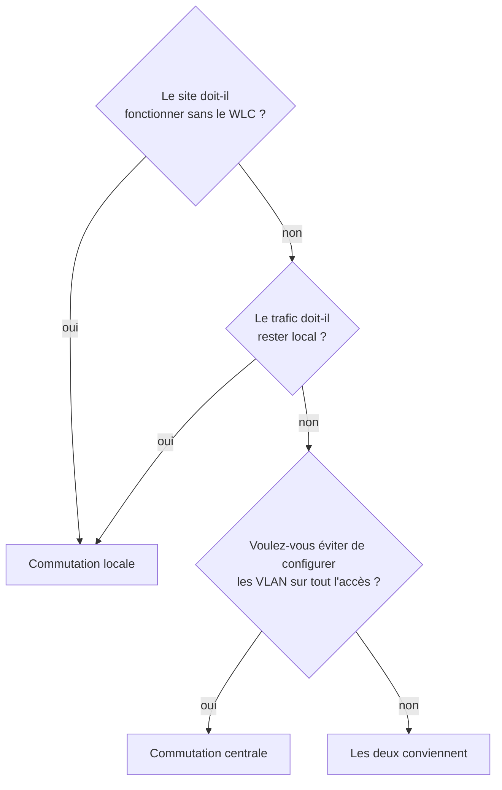

# Chapitre 5 – Comparer et choisir

**Objectif :** comparer les deux modes et choisir celui qui convient à un SSID donné.

## 5.1 Le tableau de comparaison

| Critère | Commutation **centrale** | Commutation **locale** (FlexConnect) |
|---|---|---|
| Où la trame du client est-elle terminée ? | Au **WLC** | Au **LAP** |
| Chemin des données | LAP → tunnel → WLC → distribution | LAP → accès → distribution |
| Port du LAP sur l'accès | **Accès** (VLAN des LAP) | **Trunk** (natif = VLAN des LAP) |
| VLAN des clients sur l'accès | **Absent** | **Présent**, sur tous les commutateurs concernés |
| VLAN des clients sur le trunk du WLC | **Obligatoire** | Inutile pour ce trafic |
| VLAN des clients dans le profil Flex | Sans objet | **Obligatoire** |
| Goulot d'étranglement | Le **WLC** | Aucun |
| Si le LAP perd le WLC | Service **interrompu** | Clients connectés **peuvent rester** |
| Itinérance entre LAP | Simple : même WLC, même VLAN | Le VLAN doit exister partout où le client peut aller |
| Où les politiques s'appliquent | Au **WLC** | Au LAP et sur le réseau filaire |
| Cas typique | Campus, tout le trafic à contrôler | Succursale distante, trafic à garder local |

## 5.2 La question à se poser

Pour chaque SSID, posez-vous ces questions, dans cet ordre :

Ce n'est pas un arbre absolu : c'est un guide. Un site avec un WLC éloigné (liaison WAN) penche vers le **local** ; un campus avec des commutateurs d'accès nombreux et un WLC robuste penche vers le **central**.

## 5.3 On peut mélanger

Un même LAP en mode **FlexConnect** peut servir **plusieurs SSID** avec des modes différents, car le choix se fait **par profil Policy**. Exemple :

| SSID | VLAN | Profil Policy | Mode |
|---|---|---|---|
| Employes | 110 | POL-EMPLOYES-CENTRAL | **Central** : accès aux ressources de l'entreprise, politique centralisée |
| Invites | 120 | POL-INVITES-LOCAL | **Local** : sortie Internet directe, sans surcharger le WLC |

Ce LAP est en **mode FlexConnect** (Site tag), et son Policy tag associe chaque SSID à son profil Policy. Les trames d'« Employes » vont au WLC dans le tunnel ; celles d'« Invites » sortent localement.

:::warning[Un LAP en mode FlexConnect doit être configuré pour les deux]
Même si un SSID est central, le LAP en mode FlexConnect doit avoir son **trunk** (si au moins un SSID est local) et son **profil Flex**. Le port d'accès ne suffit plus dès que l'un des SSID est local.
:::

## 5.4 Grille de décision

À vous d'appliquer. Pour chaque situation, indiquez le **mode**, le **type de port** du LAP et où le VLAN doit être autorisé (le corrigé est dans les exercices du chapitre 9).

| Situation | Mode ? | Port du LAP ? | VLAN à autoriser où ? |
|---|---|---|---|
| SSID **invités** d'un campus, trafic vers Internet seulement | ? | ? | ? |
| SSID **employés** d'un campus, accès aux serveurs internes, politique centralisée | ? | ? | ? |
| **Succursale** distante reliée par un lien WAN lent, SSID employés | ? | ? | ? |

## À retenir

- La commutation **centrale** simplifie l'accès et centralise les politiques, mais tout passe par le **WLC**.
- La commutation **locale** évite le détour et résiste à la perte du WLC, mais demande les **VLAN sur tout l'accès**.
- Le choix se fait **par SSID** (profil Policy) ; le mode du LAP se fait **par site** (Site tag).
- On peut **mélanger** les deux sur un même LAP en mode FlexConnect.

## Vérifiez votre compréhension

**Question 1.** Citez deux critères qui poussent vers la commutation locale.

Voir le corrigé

Un **site distant** relié par un lien WAN lent ; un site qui doit **continuer à fonctionner sans le WLC** ; un trafic qu'on veut garder **local** (accès Internet direct).

**Question 2.** Citez deux critères qui poussent vers la commutation centrale.

Voir le corrigé

Vouloir **éviter de configurer les VLAN des clients sur tout l'accès** ; vouloir une **politique de trafic centralisée** ; vouloir une itinérance simple sur un campus.

**Question 3.** Un LAP en mode FlexConnect diffuse « Employes » (central) et « Invites » (local). Quel type de port faut-il sur l'accès ?

Voir le corrigé

Un **trunk** (VLAN natif = VLAN des LAP, VLAN d'« Invites » autorisé) : dès qu'un SSID est local, le LAP doit pouvoir émettre ce VLAN en 802.1Q.

**Question 4.** Le choix central ou local se fait-il par LAP, par site ou par SSID ?

Voir le corrigé

Les **deux** : le **mode du LAP** (local ou FlexConnect) se fait **par site** (Site tag) ; le **mode de commutation de chaque réseau** se fait **par SSID** (profil Policy, relié par le Policy tag).

