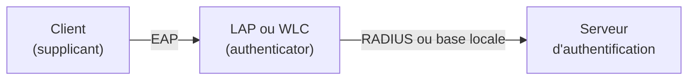

# Chapitre 6 – L'authentification : ouverte, PSK, 802.1X, locale ou centrale

**Objectif :** distinguer les types de sécurité d'un SSID, et savoir qui réalise l'authentification : le WLC (central) ou le LAP (local). Les laboratoires n'utilisent **pas de serveur RADIUS** : celui-ci est étudié au module suivant (802.1X).

## 6.1 Trois types de réseaux

| Type | Principe | Usage |
|---|---|---|
| **Ouvert** | Aucune clé : n'importe qui s'associe | Invités (souvent avec portail), tests |
| **PSK** (clé prépartagée) | Une clé commune à tous les clients | Petits réseaux, laboratoire |
| **802.1X** | Chaque utilisateur a son identifiant et son mot de passe | Réseaux d'entreprise |

Le type de sécurité se règle dans le **profil WLAN** (onglet Security). Où l'authentification se **déroule** se règle dans le **profil Policy**.

## 6.2 Les rôles en 802.1X

Le client (**supplicant**) s'authentifie auprès d'un équipement (**authenticator**) qui interroge un **serveur d'authentification** : un serveur RADIUS, ou, sans serveur, une **base d'utilisateurs locale**.

## 6.3 Authentification centrale

Le **WLC** joue le rôle d'authenticator : le LAP relaie les échanges EAP au WLC, qui valide le client. Sans serveur RADIUS, le WLC peut s'appuyer sur une base **d'utilisateurs locaux** avec la fonction **Local EAP** : c'est ce que nous expérimentons.

## 6.4 Authentification locale

Le **LAP** joue le rôle d'authenticator : il valide le client avec une base d'utilisateurs **locaux** configurée dans le **profil Flex**, ou en joignant un serveur directement. Le site reste alors capable d'authentifier de nouveaux clients **sans le WLC**.

| | Authentification centrale | Authentification locale |
|---|---|---|
| Qui valide | Le **WLC** (base locale du WLC ou RADIUS) | Le **LAP** (base du profil Flex ou RADIUS) |
| Si le WLC est perdu | Nouveaux clients refusés | Nouveaux clients acceptés |
| Gestion des comptes | À **un seul** endroit | À répliquer sur chaque site |
| Dans les labos | Local EAP sur le WLC | Utilisateurs locaux du profil Flex |

:::warning[Incertitude à valider]
Les **méthodes EAP** disponibles pour l'authentification locale d'un LAP sont **limitées** et dépendent de la version (par exemple LEAP ou EAP-FAST, mais pas forcément PEAP). La disponibilité de **Local EAP** sur le WLC virtuel doit aussi être validée. Le laboratoire 5 sert à le vérifier : notez ce que vous observez.
:::

## 6.5 Où régler quoi dans l'interface web

| Réglage | Où |
|---|---|
| Type de sécurité (ouvert, PSK, 802.1X) | Profil **WLAN** > Security |
| Authentification centrale ou locale | Profil **Policy** > General (case Central Authentication) |
| Utilisateurs locaux du WLC / Local EAP | *Configuration > Security* (AAA, utilisateurs locaux) |
| Utilisateurs locaux du LAP | Profil **Flex** > Local Authentication |

:::note[Libellés à valider]
Les noms exacts des menus varient selon la version d'IOS XE.
:::

## À retenir

- **Ouvert**, **PSK**, **802.1X** : trois niveaux de sécurité, réglés dans le profil WLAN.
- En 802.1X, trois rôles : **supplicant**, **authenticator**, **serveur d'authentification**.
- **Central** : le WLC authentifie ; **local** : le LAP authentifie, même sans le WLC.
- Sans RADIUS, on utilise des **utilisateurs locaux** (WLC ou profil Flex) ; RADIUS vient au module suivant.

## Vérifiez votre compréhension

**Question 1.** Dans quel profil règle-t-on le type de sécurité ? Et le lieu de l'authentification ?

Voir le corrigé

Le type de sécurité est dans le profil **WLAN** ; le lieu (central ou local) est dans le profil **Policy**.

**Question 2.** Quel est l'avantage de l'authentification locale en cas de perte du WLC ?

Voir le corrigé

Le LAP peut continuer d'authentifier de **nouveaux** clients sans le WLC.

**Question 3.** Pourquoi la gestion des comptes est-elle plus lourde avec l'authentification locale ?

Voir le corrigé

Parce que la base d'utilisateurs doit être **répliquée** sur chaque site (profil Flex), au lieu d'être gérée en un seul endroit.

