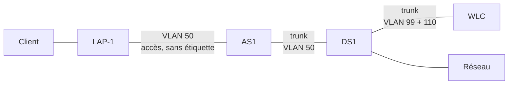
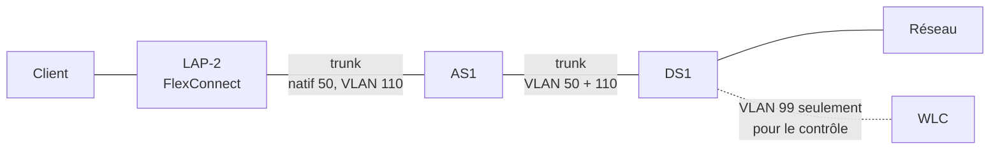

# Chapitre 6 – La chaîne des VLAN de bout en bout

**Objectif :** pour chaque mode, savoir **où le VLAN du client doit exister** sur chaque équipement du chemin, et vérifier la chaîne maillon par maillon.

C'est le chapitre le plus utile pour consolider vos connaissances de VLAN, de trunks et de MLS. Une panne de VLAN, c'est toujours **un maillon** de la chaîne qui manque.

## 6.1 La méthode : suivre la trame

Pour chaque mode, on pose la même question à chaque équipement : *« Cette trame arrive-t-elle avec quel VLAN ? Sort-elle avec quel VLAN ? Y a-t-il un maillon qui ne la laisse pas passer ? »*

## 6.2 Chaîne de la commutation centrale

Le client est sur le VLAN **110**. Le LAP est sur le VLAN **50**, le WLC (WMI) sur le VLAN **99**.

| Maillon | Ce qu'il faut |
|---|---|
| Port du LAP sur AS1 | **Accès VLAN 50** |
| Trunk AS1 ↔ DS1 | VLAN **50** autorisé (le 110 n'est **pas** nécessaire) |
| SVI 50 + HSRP sur DS1 | Passerelle du LAP |
| Trunk DS1 ↔ WLC | VLAN **99** (WMI) **et 110** (clients) autorisés |
| WLC | VLAN **110** existe ; profil Policy → VLAN 110 ; commutation centrale |
| SVI 110 + HSRP + DHCP sur DS1 | Passerelle et adresses des clients |

**À noter :** le VLAN 110 n'apparaît que sur **deux équipements** (DS1 et WLC) et sur le lien qui les relie.

## 6.3 Chaîne de la commutation locale

| Maillon | Ce qu'il faut |
|---|---|
| Port du LAP sur AS1 | **Trunk**, natif **50**, VLAN **110 autorisé** |
| Profil Flex | VLAN natif **50** ; VLAN **110** déclaré |
| Profil Policy | VLAN 110 ; **commutation locale** |
| Site tag | **Site local désactivé**, profil Flex associé |
| Trunk AS1 ↔ DS1 | VLAN **50 et 110** autorisés |
| SVI 110 + HSRP + DHCP sur DS1 | Passerelle et adresses des clients |
| Trunk DS1 ↔ WLC | Seulement le VLAN **99** : le trafic du client **n'y passe pas** |

**À noter :** le VLAN 110 apparaît sur **tout le chemin d'accès** (LAP, AS1, lien montant, DS1) mais **pas** vers le WLC.

## 6.4 Comparer d'un coup d'œil

| Où ? | Central | Local |
|---|---|---|
| Port du LAP (AS1) | Accès VLAN 50 | **Trunk** natif 50 + 110 |
| Lien AS1 ↔ DS1 | VLAN 50 | VLAN 50 **+ 110** |
| Lien DS1 ↔ WLC | VLAN 99 **+ 110** | VLAN 99 |
| VLAN sur le WLC | **110 doit exister** | Pas nécessaire pour ce trafic |
| Profil Flex | Sans objet | **VLAN 110 déclaré** |
| SVI + HSRP + DHCP (DS1) | VLAN 110 | VLAN 110 |

:::info[À retenir]
La **distribution** (SVI, HSRP, DHCP) est la **même** dans les deux modes : c'est la passerelle des clients. Ce qui change, c'est **par où le VLAN du client arrive** à la distribution : par le **trunk du WLC** (central) ou par le **trunk de l'accès** (local).
:::

## 6.5 Le VLAN natif : le piège du trunk du LAP

En commutation locale, le port du LAP est un trunk. Le **VLAN natif** de ce trunk doit être :

- le **VLAN des LAP** (50) : c'est dans ce VLAN que le LAP obtient son adresse et joint le WLC ;
- **identique** à la valeur du **profil Flex** et du **côté commutateur**.

Si le natif du trunk était, par exemple, le VLAN 1 : le LAP n'obtiendrait pas d'adresse dans le VLAN 50 et ne joindrait jamais le WLC. Si le natif diffère entre le LAP et le commutateur, vous retrouvez le problème classique de **VLAN natif différent des deux côtés d'un trunk**.

## 6.6 HSRP et la résilience

Les passerelles des clients (10.0.110.1, 10.0.120.1) sont des **adresses virtuelles HSRP** sur DS1 et DS2. Ce qui change entre les modes :

- **Central** : le trafic des clients arrive à DS1/DS2 par le **trunk du WLC**. Si le trunk du WLC n'est raccordé qu'à DS1, c'est un point de défaillance : on raccorde le WLC aux **deux** distributions (port-channel multi-châssis, ou liens séparés).
- **Local** : le trafic arrive par les **trunks de l'accès** vers DS1 et DS2 : on retrouve la redondance habituelle (LACP, STP, HSRP) du réseau d'accès.

## 6.7 Mini-exercice : tracer le VLAN 120

Reprenez le tableau 6.4 pour le VLAN **120** (SSID « Invites »). Le LAP-2 est en FlexConnect et « Invites » est en commutation **locale**. Listez **tous les endroits** où le VLAN 120 doit apparaître (équipement + lien + profil). Le corrigé est ci-dessous.

Voir le corrigé

- **Profil Policy** (POL-INVITES-LOCAL) : VLAN 120, commutation locale.
- **Profil Flex** : VLAN 120 déclaré.
- **Port du LAP-2 sur AS1** : trunk, VLAN 120 **autorisé**.
- **Lien AS1 ↔ DS1 et DS2** : VLAN 120 **autorisé**.
- **DS1 / DS2** : SVI 120, HSRP 10.0.120.1, DHCP (pool ou `ip helper-address`).
- **Pas nécessaire** : trunk DS1 ↔ WLC.

## À retenir

- La chaîne d'un VLAN, c'est la liste des **maillons** où il doit exister : **toute panne est un maillon manquant**.
- **Central** : le VLAN client passe par le **trunk du WLC** ; l'accès ne voit que le VLAN 50.
- **Local** : le VLAN client passe par le **trunk du LAP** et les **liens montants** ; le WLC ne le voit pas.
- La **distribution** (SVI, HSRP, DHCP) est la même dans les deux modes.
- Le **VLAN natif** doit être cohérent entre le LAP (profil Flex), le commutateur d'accès et le VLAN des LAP.

## Vérifiez votre compréhension

**Question 1.** En commutation centrale, sur quels équipements le VLAN 110 doit-il exister ?

Voir le corrigé

Sur le **WLC** et sur la **distribution** (SVI, HSRP), ainsi que sur le **trunk** qui les relie. Il n'est pas nécessaire sur l'accès.

**Question 2.** En commutation locale, le trunk DS1 ↔ WLC doit-il autoriser le VLAN 110 ?

Voir le corrigé

**Non**, pas pour le trafic des clients : il ne passe pas par le WLC. Il doit autoriser le VLAN 99 (WMI) pour la gestion.

**Question 3.** Le trunk AS1 ↔ DS1 autorise seulement le VLAN 50. Quel est l'effet pour un SSID local sur le VLAN 110 ?

Voir le corrigé

Le client s'associe et la trame sort du LAP en VLAN 110, mais elle est **bloquée** par le trunk : le client **n'obtient pas d'adresse IP**. Il faut autoriser le VLAN 110 sur le lien montant.

**Question 4.** Pourquoi l'adresse de la passerelle 10.0.110.1 ne dépend-elle pas du mode de commutation ?

Voir le corrigé

Parce que la passerelle est la **SVI HSRP de la distribution**, dans les deux modes. Seul le **chemin** de la trame jusqu'à cette SVI change.

