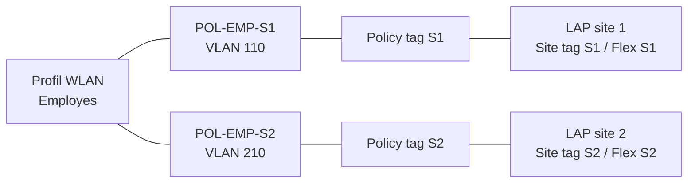

# Chapitre 7 – Les tags en situation : trois configurations de sites

**Objectif :** voir l'intérêt des profils et des tags sur trois configurations de sites Flex. Ce chapitre est **théorique** : au laboratoire, nous n'utilisons qu'un seul LAP.

:::info[Rappel important]
Deux LAP **proches** diffusent chacun leurs SSID, et un client choisit l'un ou l'autre au hasard. Pour que chaque site soit reconnaissable, **chaque LAP ou site diffuse des SSID différents**.
:::

## 7.1 Configuration A : un SSID dans un site Flex

Un site (une succursale) avec un SSID « Employes » dans le VLAN 110.

| Objet | Contenu |
|---|---|
| Profil WLAN | WLAN-EMP (SSID Employes) |
| Profil Policy | POL-EMP (VLAN 110, commutation locale) |
| Policy tag | TAG-SUCC1 : WLAN-EMP avec POL-EMP |
| Profil Flex | FLEX-SUCC1 (natif 50, VLAN 110) |
| Site tag | SITE-SUCC1 (site local désactivé) |

Tous les LAP de la succursale portent TAG-SUCC1 et SITE-SUCC1.

## 7.2 Configuration B : un SSID sur deux sites Flex

Le **même SSID** « Employes » est diffusé dans deux succursales, mais avec un **VLAN différent** par site (110 et 210). Le **profil WLAN est réutilisé** ; seuls le profil Policy, le Policy tag et le profil Flex changent.

C'est le cas qui illustre le mieux l'intérêt de la séparation : **un seul SSID** pour l'utilisateur, **un VLAN selon l'endroit**. Un Policy tag ne peut contenir qu'**une paire** par profil WLAN : on a donc besoin d'un Policy tag par site.

:::note[Une autre façon d'avoir plusieurs VLAN pour un SSID]
Un SSID peut aussi être réparti sur plusieurs VLAN par un **groupe de VLAN** ou par une valeur envoyée par le serveur d'authentification (*AAA override*, module suivant).
:::

## 7.3 Configuration C : deux SSID dans deux sites Flex

Le site 1 diffuse « S1-Employes » (VLAN 110) et le site 2 diffuse « S2-Employes » (VLAN 210). Deux profils WLAN, deux profils Policy, deux Policy tags, deux profils Flex, deux Site tags.

C'est la configuration la plus **simple à expérimenter** avec des LAP proches l'un de l'autre : chaque LAP est reconnaissable par son SSID, et le client ne peut pas se tromper de site.

## 7.4 Comparer

| | A | B | C |
|---|---|---|---|
| SSID | 1 | 1 (même nom) | 2 (noms différents) |
| Sites | 1 | 2 | 2 |
| Profils WLAN | 1 | **1** | 2 |
| Profils Policy | 1 | 2 | 2 |
| Policy tags | 1 | 2 | 2 |
| Profils Flex / Site tags | 1 / 1 | 2 / 2 | 2 / 2 |
| Particularité | Le plus simple | SSID unique, VLAN selon le site | LAP proches : SSID distincts |

## 7.5 Et au laboratoire ?

Avec **un seul LAP**, nous faisons deux étapes : d'abord **un SSID dans un VLAN**, puis **deux SSID dans deux VLAN** sur le même LAP (un Policy tag avec deux paires). Les trois configurations ci-dessus se lisent comme des variantes du même modèle.

## À retenir

- Un profil WLAN peut être **réutilisé** dans plusieurs Policy tags avec des profils Policy différents.
- **Un Policy tag par site** quand le VLAN d'un même SSID change selon le site.
- Deux LAP proches : **SSID différents** pour que le client choisisse le bon site.

## Vérifiez votre compréhension

**Question 1.** Dans la configuration B, quels objets sont réutilisés ? Lesquels sont dupliqués ?

Voir le corrigé

Le **profil WLAN** est réutilisé. Le profil Policy, le Policy tag, le profil Flex et le Site tag sont **dupliqués** (un par site).

**Question 2.** Pourquoi la configuration C convient-elle à un laboratoire avec deux LAP proches ?

Voir le corrigé

Parce que les SSID diffèrent : l'étudiant choisit explicitement le LAP dont il veut tester le site, sans risque que son poste s'associe à l'autre.

