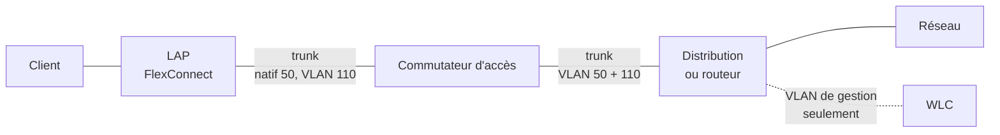
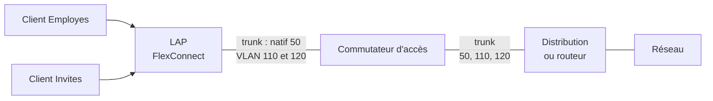

# Chapitre 8 – La chaîne des VLAN de bout en bout

**Objectif :** savoir **où le VLAN du client doit exister** sur chaque équipement du chemin, d'abord pour **un SSID et un VLAN**, puis pour **deux SSID et deux VLAN** sur le même LAP.

Une panne de VLAN, c'est toujours **un maillon** de la chaîne qui manque.

## 8.1 La méthode : suivre la trame

À chaque équipement, on pose la même question : *« Cette trame arrive-t-elle avec quel VLAN ? Sort-elle avec quel VLAN ? Y a-t-il un maillon qui ne la laisse pas passer ? »*

## 8.2 Étape 1 : un SSID, un VLAN

Le client est dans le VLAN **110**. Le LAP est dans le VLAN **50** (natif du trunk).

| Maillon | Ce qu'il faut |
|---|---|
| Profil Policy | VLAN 110 ; commutation locale |
| Profil Flex | VLAN natif **50** ; VLAN **110** déclaré |
| Site tag | **Site local désactivé**, profil Flex associé |
| Port du LAP | **Trunk**, natif **50**, VLAN **110 autorisé** |
| Lien montant | VLAN **50 et 110** autorisés |
| Passerelle (SVI ou sous-interface) | Adresse de la passerelle du VLAN 110 |
| DHCP | Pool du VLAN 110 |
| Trunk vers le WLC | Seulement le VLAN de **gestion** : le trafic du client n'y passe pas |

## 8.3 Étape 2 : deux SSID, deux VLAN, un seul LAP

On ajoute le SSID « Invites » dans le VLAN **120**. Le même Policy tag contient maintenant **deux paires** : Employes → POL-EMP (110) et Invites → POL-INV (120).

| Maillon | Ce qui change par rapport à l'étape 1 |
|---|---|
| Profil WLAN | Un **deuxième** profil WLAN (Invites) |
| Profil Policy | Un **deuxième** profil Policy (VLAN 120) |
| Policy tag | **Deux** paires WLAN → Policy |
| Profil Flex | VLAN **120 ajouté** à la liste |
| Port du LAP | VLAN **120 ajouté** aux VLAN autorisés |
| Lien montant | VLAN **120 ajouté** |
| Passerelle + DHCP | Une **deuxième** passerelle et un **deuxième** pool |

:::info[À retenir]
Le **Site tag**, le profil AP Join et le profil RF **ne changent pas** : ajouter un SSID touche le Policy tag, les profils WLAN et Policy, le profil Flex et la chaîne des VLAN.
:::

## 8.4 Le VLAN natif : le piège du trunk du LAP

Le port du LAP est un trunk. Son **VLAN natif** doit être :

- le **VLAN des LAP** (50) : c'est là que le LAP obtient son adresse et joint le WLC ;
- **identique** à la valeur du **profil Flex** et du **côté commutateur**.

Si le natif du trunk était le VLAN 1 : le LAP n'obtiendrait pas d'adresse dans le VLAN 50 et ne joindrait jamais le WLC. Si le natif diffère entre le LAP et le commutateur, on retrouve le problème classique de **VLAN natif différent des deux côtés**.

## 8.5 Mini-exercice : tracer le VLAN 120

Listez **tous les endroits** où le VLAN 120 doit apparaître pour le SSID « Invites ».

Voir le corrigé

- **Profil Policy** (POL-INV) : VLAN 120.
- **Policy tag** : paire Invites → POL-INV.
- **Profil Flex** : VLAN 120 déclaré.
- **Port du LAP** : VLAN 120 autorisé sur le trunk.
- **Lien montant** : VLAN 120 autorisé.
- **Passerelle** : adresse du VLAN 120 ; **DHCP** : pool du VLAN 120.
- **Pas nécessaire** : le trunk vers le WLC.

## À retenir

- Un VLAN, c'est une liste de **maillons** : toute panne est un maillon manquant.
- Le **VLAN des clients** circule sur le **trunk du LAP** et les **liens montants** ; le WLC ne le voit pas.
- Ajouter un SSID dans un nouveau VLAN : **profil WLAN + profil Policy + paire du Policy tag + VLAN dans le profil Flex + trunks + passerelle + DHCP**.
- Le **VLAN natif** doit être cohérent entre le LAP (profil Flex), le commutateur d'accès et le VLAN des LAP.

## Vérifiez votre compréhension

**Question 1.** Sur quels équipements le VLAN 110 doit-il exister, en commutation locale ?

Voir le corrigé

Sur le **profil Flex** (LAP), le **commutateur d'accès** (trunk du LAP et lien montant) et la **distribution ou le routeur** (passerelle, DHCP). Pas sur le WLC.

**Question 2.** Le trunk du lien montant autorise 50 et 110 seulement. Quel est l'effet pour le SSID « Invites » (VLAN 120) ?

Voir le corrigé

Les clients Invites s'associent mais n'obtiennent **pas d'adresse** : leur trame est bloquée par le lien montant. Employes continue de fonctionner.

**Question 3.** Quels objets du WLC doit-on modifier pour ajouter le SSID « Invites » sur un LAP qui diffuse déjà « Employes » ?

Voir le corrigé

Créer un **profil WLAN** et un **profil Policy**, ajouter la **paire** au Policy tag existant, et déclarer le **VLAN 120** dans le profil Flex. Le Site tag et le RF tag ne changent pas.

**Question 4.** Pourquoi la passerelle ne dépend-elle pas du WLC ?

Voir le corrigé

Parce que le trafic du client rejoint la passerelle par le **réseau d'accès**, sans passer par le WLC.

