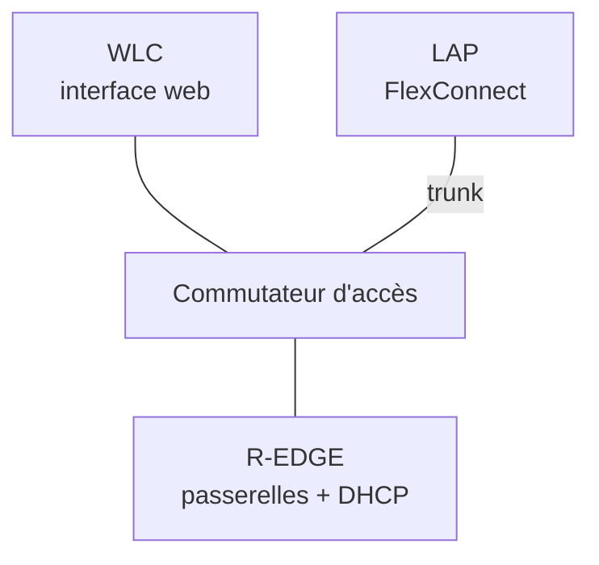

# Module 2 – Profils, tags et commutation locale

Dans le module 1, vous avez fait **joindre un LAP à un WLC**. Mais un LAP joint ne diffuse encore aucun réseau sans fil. Ce module répond à trois questions :

1. **Comment le WLC sait-il quoi configurer sur chaque LAP ?** C'est le *modèle de configuration* : profils et tags.
2. **Par où passent les données d'un client ?** Dans ce cours, toujours **directement sur le réseau filaire depuis le LAP** (commutation **locale**, mode FlexConnect). La commutation centrale est reportée à un cours ultérieur.
3. **Qui s'occupe de l'association, du DHCP et de l'authentification** : le WLC ou le LAP ?

Il est écrit pour être suivi **seul**, à votre rythme : chaque chapitre explique la matière, donne des exemples, et se termine par des questions avec corrigé.

## Ce que vous saurez faire à la fin

1. Lire un **modèle de configuration** du WLC 9800 comme un graphe : profils, tags, LAP.
2. Nommer les **cinq profils** et les **trois tags**, et expliquer l'intérêt de chacun.
3. Distinguer les **quatre fonctions** d'un profil Policy (commutation, DHCP, association, authentification) et leur côté central ou local.
4. **Prédire le chemin d'une trame** de client en commutation locale et configurer **ports, trunks et VLAN**.
5. Comparer **trois configurations de sites Flex** (un SSID / un site, un SSID / deux sites, deux SSID / deux sites).
6. Configurer **un SSID dans un VLAN**, puis **deux SSID dans deux VLAN**, sur un même LAP.
7. Expliquer l'**authentification** ouverte, PSK et 802.1X, centrale ou locale, et en expérimenter des cas **sans serveur RADIUS**.
8. **Observer** et **dépanner** en suivant la trame.

## Ce qu'il faut déjà connaître

| Notion | Où vous l'avez vue |
|---|---|
| Module 1 : WLC, LAP, CAPWAP, jonction | Module 1 de ces notes |
| VLAN, trunk 802.1Q, VLAN natif, `switchport trunk allowed vlan` | Cours de commutation |
| Routage inter-VLAN (SVI ou sous-interfaces) | Cours de commutation et de routage |
| DHCP | Cours de services réseau |

:::tip[Ce module est aussi un module sur les VLAN]
Le chapitre 8 vous fait tracer le chemin de chaque VLAN, équipement par équipement : c'est le meilleur exercice pour consolider vos connaissances de trunks et de VLAN.
:::

## Plan du module

| Chapitre | Sujet |
|---|---|
| [1](./m2-chap-1-modele.md) | Le modèle de configuration : profils et tags |
| [2](./m2-chap-2-policy.md) | Le profil Policy : une commutation locale et trois fonctions à choisir |
| [3](./m2-chap-3-local.md) | La commutation locale (FlexConnect) |
| [4](./m2-chap-4-dhcp.md) | Le DHCP : local et central |
| [5](./m2-chap-5-association.md) | L'association : local et central |
| [6](./m2-chap-6-authentification.md) | L'authentification : ouverte, PSK, 802.1X, locale ou centrale |
| [7](./m2-chap-7-situations.md) | Les tags en situation : trois configurations de sites |
| [8](./m2-chap-8-vlan.md) | La chaîne des VLAN de bout en bout |
| [9](./m2-chap-9-observer.md) | Observer et vérifier |
| [10](./m2-chap-10-depannage.md) | Dépannage |
| [11](./m2-chap-11-pas-a-pas.md) | Guide pas à pas dans l'interface web |
| [12](./m2-chap-12-synthese.md) | Synthèse et exercices |
| [Glossaire](./m2-glossaire.md) | Termes et abréviations du module 2 |

Durée suggérée : environ **3 à 4 heures** de lecture active, plus les exercices.

## Le fil rouge : la topologie du module

On reprend la topologie du module 1 : **un seul LAP** sur un trunk, un commutateur d'accès, un routeur de périphérie (R-EDGE) qui porte les passerelles et le DHCP, et le WLC joint par le réseau.

| VLAN | Rôle | Réseau |
|---|---|---|
| 50 | LAP (VLAN natif du trunk) | selon la topologie du module 1 |
| 110 | Clients du SSID **Employes** | 10.0.110.0/24 |
| 120 | Clients du SSID **Invites** | 10.0.120.0/24 |

Les numéros de VLAN et les réseaux de vos laboratoires sont précisés dans chaque énoncé. Les VLAN 110 et 120 sont ceux dont nous suivons le trajet.

:::note[Avant de commencer]
Le WLC (Catalyst 9800 sous IOS XE) se configure et se vérifie dans ce cours **uniquement par son interface web**. Les menus et certains libellés peuvent différer légèrement selon la **version** : vérifiez-les dans votre version. Les seules commandes du cours sont celles des **commutateurs** d'accès et de distribution.
:::
