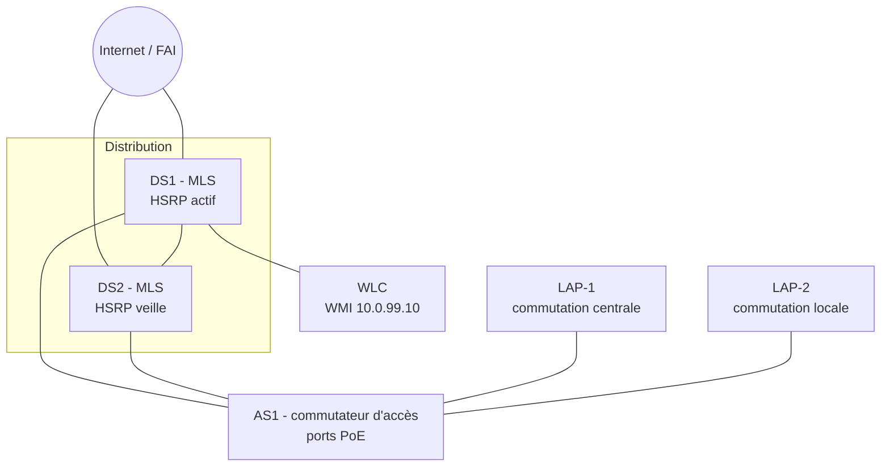

# Module 2 – Profils, tags et commutation centrale ou locale

Dans le module 1, vous avez fait **joindre un LAP à un WLC**. Mais un LAP joint ne diffuse encore aucun réseau sans fil. Ce module répond à deux questions :

1. **Comment le WLC sait-il quoi configurer sur chaque LAP ?** C'est le *modèle de configuration* : profils et tags.
2. **Par où passent les données d'un client sans fil ?** Directement sur le réseau filaire depuis le LAP (commutation **locale**), ou en passant d'abord par le WLC (commutation **centrale**) ? Et qu'est-ce que cela change à vos VLAN, trunks et passerelles ?

Il est écrit pour être suivi **seul**, à votre rythme : chaque chapitre explique la matière, donne des exemples, et se termine par des questions avec corrigé.

## Ce que vous saurez faire à la fin

1. Lire un **modèle de configuration** du WLC 9800 comme un graphe : profils, tags, LAP.
2. Nommer les **cinq profils** et les **trois tags**, et dire ce que contient chacun.
3. Distinguer les **quatre fonctions** d'un profil Policy (commutation, authentification, DHCP, association) et leur côté central ou local.
4. **Prédire le chemin d'une trame** de client dans chacun des deux modes de commutation.
5. En déduire, pour chaque mode, la configuration des **ports, trunks et VLAN** sur le LAP, l'accès, la distribution et le WLC.
6. **Choisir** un mode pour un SSID donné, en justifiant le choix.
7. **Observer** la différence avec des commandes et une capture, et **dépanner** une panne de VLAN en suivant la trame.

## Ce qu'il faut déjà connaître

| Notion | Où vous l'avez vue |
|---|---|
| Module 1 : WLC, LAP, CAPWAP, jonction | Module 1 de ces notes |
| VLAN, trunk 802.1Q, VLAN natif, `switchport trunk allowed vlan` | Cours de commutation |
| Routage inter-VLAN : SVI sur un MLS, HSRP | Cours de commutation |
| DHCP et `ip helper-address` | Cours de services réseau |

:::tip[Ce module est aussi un module sur les VLAN]
Le choix central ou local décide **où chaque VLAN doit exister** dans votre réseau. Les chapitres 3, 4 et 6 vous font tracer ce chemin VLAN par VLAN, équipement par équipement : c'est le meilleur exercice pour consolider vos VLAN et vos trunks.
:::

## Plan du module

| Chapitre | Sujet |
|---|---|
| [1](./m2-chap-1-modele.md) | Le modèle de configuration : profils et tags |
| [2](./m2-chap-2-policy.md) | Le profil Policy et ses quatre fonctions |
| [3](./m2-chap-3-central.md) | La commutation centrale |
| [4](./m2-chap-4-local.md) | La commutation locale (FlexConnect) |
| [5](./m2-chap-5-choisir.md) | Comparer et choisir |
| [6](./m2-chap-6-vlan.md) | La chaîne des VLAN de bout en bout |
| [7](./m2-chap-7-observer.md) | Observer et vérifier |
| [8](./m2-chap-8-depannage.md) | Dépannage |
| [9](./m2-chap-9-synthese.md) | Ce qu'on pratique cette année, synthèse et exercices |
| [Glossaire](./m2-glossaire.md) | Termes et abréviations du module 2 |

Durée suggérée : environ **3 à 4 heures** de lecture active, plus les exercices.

## Le fil rouge : la topologie du module

On reprend la topologie du module 1 et on y ajoute **deux réseaux sans fil** (deux SSID) et **deux LAP** configurés différemment.

| VLAN | Rôle | Réseau | Passerelle (HSRP) |
|---|---|---|---|
| 50 | LAP (gestion des points d'accès) | 10.0.50.0/24 | 10.0.50.1 |
| 99 | WLC (interface de gestion sans fil) | 10.0.99.0/24 | 10.0.99.1 |
| 110 | Clients du SSID **Employes** | 10.0.110.0/24 | 10.0.110.1 |
| 120 | Clients du SSID **Invites** | 10.0.120.0/24 | 10.0.120.1 |

Gardez ce tableau sous les yeux : les VLAN 110 et 120 sont ceux dont nous suivrons le trajet dans chaque mode.

:::note[Avant de commencer]
Les commandes de ce module sont celles d'un Catalyst 9800 sous IOS XE. Les menus et certains libellés peuvent différer légèrement selon la **version**. Les exemples de commandes sont donnés pour comprendre la logique : vérifiez toujours la syntaxe exacte dans la documentation de votre version.
:::
